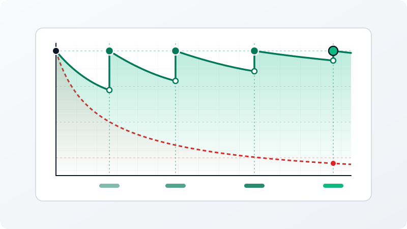
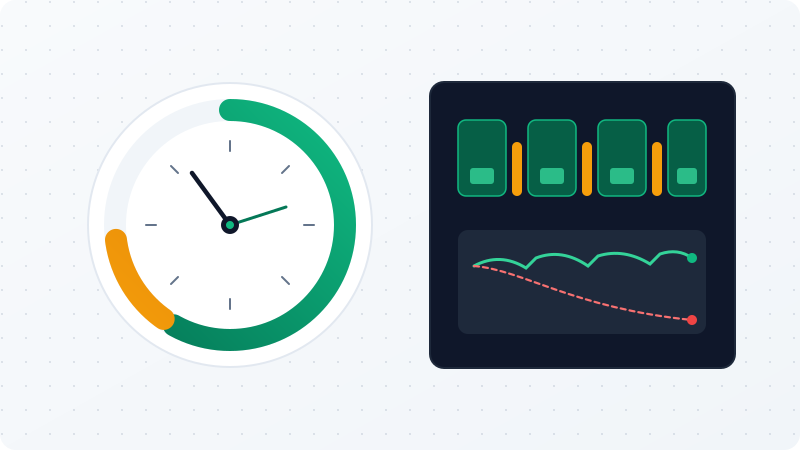
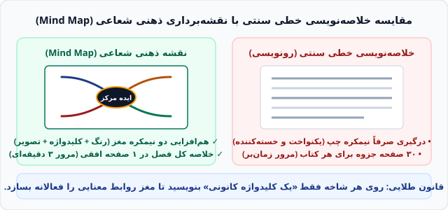

# گزارش جامع و موثق ممیزی محتوا، تحلیل افزونگی و نقشه راه بهینه‌سازی وب‌سایت «ذهن آزاد»
## مرجع رسمی مهندسی محتوا و بازطراحی معماری لندینگ‌پیج و وبلاگ (Milestone M1)

**تاریخ تدوین سند:** ۲۹ اکتبر ۲۰۲۶ (برابر با ۷ آبان ۱۴۰۵)  
**نسخه سند:** ۱.۰.۰ — نهایی و لازم‌الاجرا  
**محدوده ممیزی:** کلیه ساختارها و محتویات وب‌سایت آکادمی «ذهن آزاد» (`D:\Desktop\ai\site\index.html`)  
**مرجع اسناد بالادستی:** `ORIGINAL_REQUEST.md`، `PROJECT.md` و گزارش‌های فنی کاوشگرهای سه‌گانه (`survey_c1`، `survey_c2`، `survey_c3`)  
**نویسنده و عامل ممیزی:** کارگروه تخصصی ممیزی محتوا و کیفیت آکادمی ذهن آزاد (`teamwork_worker_m1_c`)  

---

## فهرست سرفصل‌های سند

1. **بخش اول: خلاصه مدیریتی و اجرایی (Executive Summary)**
   - تشریح وضعیت موجود (۶,۱۲۵ کلمه در ۱۷ بخش ساختاری)
   - شناسایی ۴ چالش محتوایی و ساختاری بنیادین
   - هدف‌گذاری کمی بهینه‌سازی به ۳,۵۹۱ کلمه (کاهش ۴۱.۳ درصدی)
2. **بخش دوم: کالبدشکافی سرفصل‌به‌سرفصل تمامی ۱۷ بخش صفحه اصلی**
   - تحلیل ارکان ۵‌گانه برای تک‌تک ۱۷ بخش سند HTML
   - ارزیابی دقیق تناسب محتوا با هدف استراتژیک، کشف انحرافات و تعیین کلمات بهینه
3. **بخش سوم: تحلیل عمیق محتواهای تکراری و افزونگی‌ها (Redundancy Analysis)**
   - کالبدشکافی ۵ خوشه تکراری کانونی (ابینگهاوس، نقشه ذهنی، گفتار باطنی، پومودورو، پرسوناهای تکراری)
   - ارائه راهکار قطعی و تمایز دقیق میان «حذف کامل»، «جایگزینی هوشمند» یا «انتقال به وبلاگ»
4. **بخش چهارم: جدول جامع تعداد کلمات بهینه و چگالی هدف (Word Count Target Table)**
   - جدول ماتریسی مقایسه سطر به سطر ۱۷ بخش: کلمات فعلی، کلمات بهینه، دلتا، درصد تغییر، چگالی و منطق بهینه‌سازی
5. **بخش پنجم: ممیزی نقاط تبدیل و پالایش دکمه‌های مشاوره (Consultation CTA Audit)**
   - سیاهه و موقعیت دقیق ۱۸ دکمه و لینک مشاوره و تماس در صفحه فعلی
   - آسیب‌شناسی خستگی روانی مخاطب و پدیده «خستگی مشاوره» (Consultation Fatigue)
   - برنامه قطعی کاهش و تمرکز از ۱۸ نقطه مزاحم به ۴ نقطه استراتژیک، باوقار و ارزش‌محور
6. **بخش ششم: نقشه راه عملیاتی بازطراحی ۳ حوزه کلیدی**
   - حوزه ۱: تثبیت الگوی تک‌دوره‌ای (دوره جامع کارگاهی ۲۲ سرفصلی در ۴ فاز در `#courses` و رفع نشت‌های چنددوره‌ای)
   - حوزه ۲: معماری مدرن و تمام‌متنی تجربیات دانش‌پذیران (`#testimonials`)، حذف مدیاها و پنجره لایت‌باکس
   - حوزه ۳: تاسیس سیستم مستقل وبلاگ چندصفحه‌ای، ایجاد ردیف کارت‌های وبلاگ در صفحه اصلی و یکپارچه‌سازی ناوبری

---

## ۱. خلاصه مدیریتی و اجرایی (Executive Summary)

### ۱.۱. وضعیت موجود و زمینه ممیزی
وب‌سایت آکادمی «ذهن آزاد» (`azazmind.ir`) به عنوان پایگاه رسمی معرفی و ثبت‌نام در دوره تخصصی کارگاهی تندخوانی، تقویت حافظه و مدیریت تمرکز سرکار خانم فاطمه آزادخواه پایه‌گذاری شده است. ارزیابی عمیق، خط‌به‌خط و کلمه‌به‌کلمه صفحه فرود اصلی (`site/index.html` شامل ۲,۳۹۷ سطر کد) نشان می‌دهد که این سند در حال حاضر دربرگیرنده **۶,۱۲۵ کلمه متن تمیز (Clean Text Words)** است که در قالب **۱۷ بخش ساختاری (Structural Sections)** چیده شده است.

اگرچه کدهای فرانت‌اند از حیث ساختار نشانه‌گذاری معنایی HTML5، سبک‌های مدرن CSS بدون وابستگی به فریم‌ورک‌های سنگین و رعایت مقدماتی معیارهای دسترس‌پذیری در سطح قابل قبولی قرار دارند، اما از حیث **استراتژی محتوا، معماری اطلاعات و روان‌شناسی نرخ تبدیل (Conversion Rate Optimization)** دچار تورم شدید و گره‌های تعارضی با الزامات صریح کارفرما در سند `ORIGINAL_REQUEST.md` هستند.

```
┌────────────────────────────────────────────────────────────────────────┐
│                   وضعیت محتوایی صفحه فرود در وضع موجود                  │
├────────────────────────────────────────────────────────────────────────┤
│ • حجم کلمات تمیز صفحه اصلی: ۶,۱۲۵ کلمه                                  │
│ • تعداد کل بخش‌های محتوایی: ۱۷ بخش مجزا                                │
│ • تعداد دکمه‌ها و لینک‌های دعوت به مشاوره و تماس: ۱۸ نقطه تماس         │
│ • ساختار معرفی دوره: ۲ کارت تفکیک‌شده موازی + ابزارهای کارگاهی حجیم     │
│ • بخش اثبات اجتماعی: ۳ تصویر وکتوری SVG + دکمه‌های زوم + پنجره لایت‌باکس│
│ • بخش مقالات: ۴ مقاله آموزشی بلند بازشونده در بدنه صفحه اصلی          │
└────────────────────────────────────────────────────────────────────────┘
```

---

### ۱.۲. شناسایی ۴ چالش محتوایی و ساختاری بنیادین

تحلیل داده‌های ممیزی نشان می‌دهد که افت کارایی و سردرگمی مخاطبان در این وب‌سایت ناشی از چهار چالش اساسی است:

#### چالش اول: تورم شدید محتوا و تکرار چرخه‌ای ۵ مفهوم کلیدی (Content Inflation & Cognitive Overload)
بررسی واژگانی صفحه نشان می‌دهد که ۵ مفهوم علمی و تکنیکی اصلی به جای آن‌که در موضع تخصصی خود شرح داده شوند، در یک چرخه تکرار فرساینده در بخش‌های مختلف بازتعریف شده‌اند. به عنوان نمونه:
- پدیده «منحنی فراموشی ابینگهاوس» در **۹ بخش مختلف** صفحه تکرار شده است.
- تکنیک «نقشه‌برداری ذهنی (Mind Map)» در **۸ بخش مجزا** مورد بحث قرار گرفته و حتی دیاگرام کامل آن در میانه معرفی دوره ترسیم شده است.
- مفهوم «گفتار باطنی و زیرلب‌خوانی (Subvocalization)» در **۹ بخش** تکرار شده و حتی متن آزمون تعیین سرعت مطالعه نیز به جای یک متن عمومی، به توضیح این مفهوم اختصاص یافته است.
- «تکنیک پومودورو» در **۵ بخش** و پرسوناهای تکراری مخاطبان (کنکور، وکالت، دکتری) در **۳ بخش طویل** بازگو شده‌اند. این تکرار مکرر سبب خستگی شناختی مخاطب شده و ارزش تازگی محتوا را نابود می‌کند.

#### چالش دوم: نقض صریح ساختار تک‌دوره‌ای در بخش `#courses` و نشت چنددوره‌ای
طبق بند صریح دستور کارفرما در `ORIGINAL_REQUEST.md`:
> *«سایت ذهن آزاد فقط یک دوره آموزشی دارد که شامل ۲۲ سرفصل می‌باشد؛ این بدان معنی است که در بخش مخصوص معرفی دوره فقط و فقط یک دوره باید معرفی شود که شامل ۲۲ سرفصل است و سایر موارد دیگر نباید درون آن وجود داشته باشد.»*

با این حال، در وضعیت فعلی بخش `#courses`:
1. با چیدمان شبکه دو کارته (`.grid-2`) پیاده شده و کارت اول را «آموزش گام‌به‌گام ۲۲ سرفصل» و کارت دوم را «مهندسی ادراک بصری و تثبیت در حافظه بلندمدت» نامیده است. این چیدمان دوگانه این تصور گمراه‌کننده را ایجاد می‌کند که دو پکیج یا دو دوره آموزشی مجزا در آکادمی ارائه می‌شود.
2. علاوه بر دو کارت مذکور، یک بلوک حجیم به نام `course-tools-showcase` شامل یک جدول تعاملی ۲۵ خانه‌ای شولت و یک دیاگرام بزرگ SVG نقشه ذهنی مستقیماً در این بخش گنجانده شده که به عنوان ابزارهای مداخله‌گر، تمرکز معرفی دوره را مخدوش می‌کنند.
3. در فرم مشاوره انتهای صفحه (`#consultation`) نیز یک منوی کشویی حاوی ۴ گزینه مختلف دوره‌ای تعبیه شده و در اسکریپت آزمون سرعت مطالعه (`script.js`) در صورت پایین بودن درک مطلب، دوره‌ای جعلی به نام «تقویت تمرکز و خلاصه‌برداری با Mind Map» پیشنهاد می‌گردد!

#### چالش سوم: مغایرت بصری و سنگینی مدیا در بخش تجربیات دانش‌پذیران (`#testimonials`)
طبق دستور صریح کارفرما:
> *«همچنین برای بخش "تجربه دانش‌پذیران و نمونه کارهای واقعی دوره" نیازی به محتوا تصویری و فیلم نیست؛ متن کافی است.»*

برخلاف این دستور، بخش فعلی شامل ۳ تصویر وکتوری بزرگ SVG، ۳ دکمه زوم اختصاصی (`.visual-zoom-trigger`) و یک پنجره کامل لایت‌باکس مودال جاوااسکریپتی (`#image-lightbox-modal`) در انتهای کد صفحه است. این مدیاهای گرافیکی علاوه بر نقض دستور مستقیم، حجم DOM و زمان رندر اولیه صفحه را بی‌دلیل افزایش داده‌اند.

#### چالش چهارم: پدیده «خستگی مشاوره» ناشی از اشباع ۱۸ نقطه تماس تهاجمی (Consultation Fatigue)
طبق فرمان سوم کارفرما:
> *«درون صفحه اصلی نباید زیاد از لینک و یا دکمه یا هر چیزی دیگری که مربوط می‌شوند به مشاوره، صحبت با مدرس یا مشاوره رایگان استفاده شود.»*

اما در صفحه موجود، **۱۸ دکمه، لینک و فراخوان مجزا** کاربر را به مشاوره یا تماس تلفنی دعوت می‌کنند؛ به طوری که در انتهای تقریباً تمامی بخش‌ها (هدر، دراور موبایل، هیرو، چالش‌ها، دوره، مدرس، آزمون سرعت، سرفصل‌ها، سوالات متداول، فوتر و نوار چسبان موبایل) دکمه‌های مشاوره بمباران شده‌اند. این اصرار تهاجمی، ذهنیت کاربر را از یک نهاد آموزشی معتبر به یک ساختار فشار فروش تغییر داده و طبق قانون هیک و کوری بنری، نرخ تبدیل واقعی را به شدت تنزل می‌دهد.

#### چالش پنجم: حبس ۴ مقاله تفصیلی در لندینگ‌پیج به جای ساختار وبلاگ مستقل (`#articles`)
بخش موسوم به «راهنماهای کاربردی مطالعه · نمایش تدریجی» دارای ۷۴۱ کلمه محتوای تفصیلی، ۴ تصویر SVG، منوهای آکاردئونی `<details>` با مراحل گام‌به‌گام ۱ و ۲ و ۳ است. این بخش طول صفحه اصلی را بیش از حد افزایش داده و فرصت جذب ترافیک ارگانیک سئو از طریق صفحات منفرد وبلاگ را سلب کرده است.

---

### ۱.۳. هدف‌گذاری کمی بهینه‌سازی
هدف از این طرح بهینه‌سازی، تبدیل صفحه اصلی «ذهن آزاد» از یک صفحه متورم و تکراری به یک لندینگ‌پیج سریع، باوقار، علمی و پربازده است:

```
┌────────────────────────────────────────────────────────────────────────┐
│                        شاخص‌های هدف‌گذاری ممیزی                         │
├────────────────────────────────────────────────────────────────────────┤
│ • تعداد کلمات صفحه اصلی: از ۶,۱۲۵ به ۳,۵۹۱ کلمه (کاهش ۴۱.۳٪ / -۲,۵۳۴ کلمه) │
│ • تعداد دکمه‌های مشاوره: از ۱۸ نقطه تماس تهاجمی به ۴ نقطه استراتژیک (-۷۷.۷٪)│
│ • ساختار معرفی دوره: تبدیل ۲ کارت و ابزارها به ۱ ویترین پرچمدار تک‌دوره‌ای │
│ • بخش اثبات اجتماعی: حذف ۱۰۰٪ تصاویر/لایت‌باکس و استقرار ۳ کارت متنی اصیل  │
│ • ساختار وبلاگ: استخراج مقالات به هاب مستقل (`blog/`) و ۴ صفحه منفرد پست  │
│ • کارت‌های وبلاگ در صفحه اصلی: ۱ ردیف ۴ کارته سبک و شیک (۱۴۰ کلمه)     │
└────────────────────────────────────────────────────────────────────────┘
```

این پالایش محتوایی، افزونگی‌ها را کاملاً محو کرده و تمرکز کاربر را مستقیماً به سمت ارزش اصلی آکادمی یعنی **تنها دوره جامع کارگاهی ۲۲ سرفصلی با تدریس فاطمه آزادخواه** معطوف می‌سازد.

---

## ۲. کالبدشکافی سرفصل‌به‌سرفصل تمامی ۱۷ بخش صفحه اصلی

در این بخش، تک‌تک ۱۷ بخش سند `index.html` از منظر ۵ مولفه حیاتی کالبدشکافی می‌شوند:
1. **هدف استراتژیک بخش**
2. **تعداد کلمات تمیز فعلی**
3. **بررسی دقیق تناسب محتوا با هدف بخش (Content Appropriateness)**
4. **نقاط ضعف، انحرافات و عدم انطباق با الزامات کارفرما**
5. **تعداد کلمات بهینه و صحیح و جهت‌گیری بازطراحی**

---

### بخش ۱: هدر اصلی و منوی کشویی موبایل (`#site-header` و `.mobile-drawer`)
- **محدوده سطرها در کد منبع:** سطرهای ۵۲ تا ۱۰۸ (شامل ناوبری دسکتاپ و دراور واکنش‌گرای موبایل)
- **هدف استراتژیک بخش:** تثبیت هویت بصری برند («آکادمی ذهن آزاد»)، ارائه ناوبری سریع و شفاف به ارکان اصلی صفحه فرود، و ایجاد یک دسترسی موقر به اقدام کلیدی.
- **تعداد کلمات فعلی:** ۱۵ کلمه در ناوبری دسکتاپ (بدون احتساب متون تکراری دراور موبایل).
- **بررسی تناسب محتوا با هدف:**
  - ساختار پیوندهای دسکتاپ شامل ۶ پیوند اصلی (`درباره دوره`، `درباره مدرس`، `آزمون سرعت مطالعه`، `سرفصل‌های دوره`، `مبانی علمی`، `سوالات متداول`) و ۱ دکمه برجسته در گوشه چپ است. این چینش از نظر خوانایی مناسب است.
  - اما از منظر سلسله‌مراتب ناوبری، **یک غفلت اساسی** رخ داده است: طبق الزام کارفرما، پیوند به «وبلاگ» باید به عنوان یکی از ستون‌های اصلی محتوا در هدر حضور داشته باشد که در حال حاضر به کلی غایب است.
- **نقاط ضعف و انحرافات محتوایی:**
  1. فقدان پیوند مستقیم به «وبلاگ» در هدر دسکتاپ و دراور موبایل.
  2. تراکم افراطی دکمه‌های مشاوره در دراور موبایل (`mobile-drawer`): در منوی موبایل علاوه بر لینک «درخواست مشاوره رایگان ←» در فهرست، در انتهای کشو نیز **۲ دکمه تمام‌عرض بزرگ** تحت عناوین «ثبت درخواست مشاوره رایگان» و «تماس مستقیم: ۰۹۱۲۱۲۰۵۵۶۰» تعبیه شده است! این تراکم، منوی ناوبری را از یک ابزار راهنما به یک تابلوی فروش فوری بدل ساخته است.
- **تعداد کلمات بهینه:** **۲۰ کلمه** (+۵ کلمه / افزایش ۳۳ درصدی برای درج لینک‌های وبلاگ و اصلاح عناوین).
- **جهت‌گیری اصلاحی:** افزودن پیوند `<li><a href="./blog/index.html" class="site-nav__link">وبلاگ</a></li>` به هدر دسکتاپ و دراور موبایل؛ حذف ۲ دکمه موازی انتهای دراور موبایل و اکتفا به یک لینک تمیز و منسجم.

---

### بخش ۲: پرده ورودی و ارزش پیشنهادی هیرو (`#hero`)
- **محدوده سطرها در کد منبع:** سطرهای ۱۱۱ تا ۲۳۱
- **هدف استراتژیک بخش:** جلب توجه آنی مخاطب در ۵ ثانیه نخست (First Impression)، تبیین گزاره ارزش یکتا (UVP)، بیان جامعه هدف و ارائه ۲ مسیر اقدام روشن: یک اقدام تعاملی و کم‌ریسک (سنجش سرعت مطالعه) و یک اقدام هدایت‌شده (بررسی سرفصل‌های دوره یا مشاوره تعیین سطح).
- **تعداد کلمات فعلی:** ۱۹۵ کلمه تمیز.
- **بررسی تناسب محتوا با هدف:**
  - تیتر اصلی («آموزش تخصصی تندخوانی و تقویت حافظه — افزایش سرعت مطالعه همراه با درک مطلب پایدار») و ۴ شاخص هیرو (افزایش سرعت، تثبیت درک مطلب، مرورهای ابینگهاوس و پشتیبانی کارگاهی) دقیقاً با ارزش‌های اصلی آکادمی هم‌راستا هستند.
- **نقاط ضعف و انحرافات محتوایی:**
  1. اشباع بیش از حد دکمه‌های اقدام: در این بخش به تنهایی **۴ دکمه مختلف** قرار گرفته است: دکمه بنفش اصلی (`دریافت مشاوره و تعیین سطح رایگان`)، دکمه ثانویه خاکستری (`سنجش آنلاین سرعت مطالعه WPM`)، دکمه تماس واتساپ (`پیام در واتساپ`) و دکمه تماس تلفنی مستقیم (`تماس مستقیم`). این تعدد گزینه‌ها طبق قانون هیک موجب فلج تحلیلی کاربر و افت نرخ تعامل می‌شود.
  2. ورود پیش‌هنگام به جزئیات تکنیک‌ها: در متن پاراگراف هیرو مستقیماً واژه‌های «گفتار باطنی» و «ابینگهاوس» بازگو شده‌اند که قبل از ایجاد زمینه ذهنی، برای کاربر ناآشنا گنگ هستند.
- **تعداد کلمات بهینه:** **۱۵۰ کلمه** (-۴۵ کلمه / کاهش ۲۳ درصدی).
- **جهت‌گیری اصلاحی:** حذف دکمه‌های مستقیم واتساپ و تماس تلفنی از بخش هیرو؛ تمرکز منحصربه‌فرد بر دو دکمه اصلی: «دریافت مشاوره و تعیین سطح» (CTA اولیه) و «سنجش آنلاین سرعت مطالعه WPM» (CTA تعاملی ثانویه)؛ خلاصه‌سازی پاراگراف توضیحی هیرو.

---

### بخش ۳: کالبدشکافی نقاط درد و چالش‌های مطالعه (`#pain-points`)
- **محدوده سطرها در کد منبع:** سطرهای ۲۳۲ تا ۳۸۶
- **هدف استراتژیک بخش:** ایجاد همذات‌پنداری عاطفی و شناختی با داوطلبان کنکور، وکالت، دکتری و پژوهشگران؛ نشان دادن این حقیقت علمی که ریشه کندخوانی و حواس‌پرتی در کم‌هوشی نیست بلکه در آموزش نادرست عضلات چشم و الگوهای سنتی است.
- **تعداد کلمات فعلی:** ۵۶۹ کلمه تمیز.
- **بررسی تناسب محتوا با هدف:**
  - ۶ کارت چالش (خیره ماندن به صفحه، بلعیده شدن زمان با وسواس، کابوس فراموشی فرمول‌ها، سنگینی پلک و اعتیاد به گوشی، تله رونویسی خطی، و کمبود وقت سر جلسه آزمون) با بینش فوق‌العاده و ادبیاتی ملموس نگاشته شده‌اند.
  - تعاملی بودن کارت‌ها با دکمه‌های شمارشگر `+ این مشکل من است` نرخ ماندگاری کاربر را به شدت تقویت می‌کند.
- **نقاط ضعف و انحرافات محتوایی:**
  1. توضیحات زیر هر چالش اندکی به درازا کشیده و از اصل اسکن‌پذیری سریع (Scannability) فاصله گرفته است.
  2. **انحراف استراتژیک در دکمه پایانی بخش:** در انتهای این بخش دکمه‌ای با برچسب `دریافت راهکار اختصاصی رفع چالش‌های مطالعه` تعبیه شده که مستقیماً کاربر را به فرم مشاوره انتهای صفحه (`#consultation`) منتقل می‌کند! کاربری که در ابتدای صفحه تازه چالش‌های خود را لمس کرده، هنوز راه‌حل، دوره و مدرس را نشناخته است و کشاندن اجباری او به فرم ثبت‌نام، رفتاری نامتناسب و تهاجمی تلقی می‌شود.
- **تعداد کلمات بهینه:** **۴۲۰ کلمه** (-۱۴۹ کلمه / کاهش ۲۶ درصدی).
- **جهت‌گیری اصلاحی:** فشرده‌سازی متن تشریحی ۶ چالش به جملات ضربتی؛ تغییر مقصد دکمه پایانی از فرم مشاوره به بخش بعدی یعنی شبیه‌ساز حرکت چشم (`#transformation`) با متنی ترغیب‌کننده نظیر «مشاهده ریشه عضلانی چالش‌ها در شبیه‌ساز حرکت چشم ←».

---

### بخش ۴: شبیه‌ساز حرکت چشم در مطالعه (`#transformation`)
- **محدوده سطرها در کد منبع:** سطرهای ۳۸۷ تا ۴۵۶
- **هدف استراتژیک بخش:** ایجاد گذار شناختی از مشکل به راه‌حل؛ اثبات تجربی و عینی این واقعیت که چشم انسان قابلیت ثبت دسته‌بندی‌شده کلمات (Chunking) را دارد و تک‌کلمه‌خوانی سنتی مسبب خستگی مفرط است.
- **تعداد کلمات فعلی:** ۱۶۲ کلمه تمیز.
- **بررسی تناسب محتوا با هدف:**
  - این بخش یکی از بی‌نقص‌ترین بخش‌های وب‌سایت از حیث طراحی تجربه کاربری است. متن کاملاً در خدمت کارکرد ابزار تعاملی است، کاربر تفاوت ۲۵۰ کلمه در دقیقه با ۵۵۰ کلمه در دقیقه را به چشم می‌بیند و هیچ پیام تبلیغاتی یا دکمه مشاوره‌ای مزاحمی در آن وجود ندارد.
- **نقاط ضعف و انحرافات محتوایی:**
  - انحراف بنیادینی مشاهده نشد؛ تنها میکروکپی‌های مقایسه‌ای ستون اول و دوم قابلیت ارتقای روانی نگارش و تنظیم فواصل نیم‌فاصله را دارند.
- **تعداد کلمات بهینه:** **۱۴۰ کلمه** (-۲۲ کلمه / کاهش ۱۴ درصدی جهت ایجاز بیشتر).
- **جهت‌گیری اصلاحی:** حفظ ۱۰۰ درصدی ساختار ابزار جاوااسکریپتی؛ روان‌سازی عبارات تشریحی قبل و بعد از مقایسه.

---

### بخش ۵: معرفی دوره آموزشی (`#courses`)
- **محدوده سطرها در کد منبع:** سطرهای ۴۵۷ تا ۶۹۳
- **هدف استراتژیک بخش:** معرفی یکپارچه و رسمی «تنها دوره جامع کارگاهی آکادمی ذهن آزاد» (شامل ۲۲ سرفصل در ۴ فاز پیوسته)، مشخصات دوره، تعهد زمانی، شیوه نظارت کارگاهی و دستاوردهای آن.
- **تعداد کلمات فعلی:** ۴۳۲ کلمه (به انضمام ۲۵ دکمه تعاملی جدول شولت و دیاگرام SVG مایند مپ).
- **بررسی تناسب محتوا با هدف و تخلفات آشکار از دستور کارفرما:**
  - **دستور مستقیم کارفرما:** *«سایت ذهن آزاد فقط یک دوره آموزشی دارد که شامل ۲۲ سرفصل می‌باشد؛ این بدان معنی است که در بخش مخصوص معرفی دوره فقط و فقط یک دوره باید معرفی شود که شامل ۲۲ سرفصل است و سایر موارد دیگر نباید درون آن وجود داشته باشد.»*
  - **کالبدشکافی وضعیت موجود:** این بخش در حال حاضر دچار شدیدترین انحراف محتوایی و معماری در کل وب‌سایت است:
    1. **چیدمان گمراه‌کننده دو کارته (`.grid-2`):** بخش دوره به دو کارت مجزا با کلاس یکسان تقسیم شده است: کارت اول با عنوان «آموزش گام‌به‌گام ۲۲ سرفصل تخصصی» و کارت دوم (`#fast-reading-detail`) با عنوان «مهندسی ادراک بصری و تثبیت در حافظه بلندمدت». این چیدمان بلافاصله در ذهن کاربر این توهم را می‌سازد که آکادمی ۲ دوره مختلف دارد یا دوره به دو سطح مقدماتی و پیشرفته با ثبت‌نام‌های جداگانه تقسیم شده است.
    2. **حضور ابزارهای کارگاهی حجیم (`course-tools-showcase`):** در زیر این دو کارت، یک بخش بزرگ شامل یک جدول ۲۵ خانه‌ای تعاملی شولت (Schulte Table) و یک دیاگرام گسترده نقشه‌برداری ذهنی قرار گرفته است! این ابزارها عملاً معرفی دوره نیستند؛ بلکه تمرین‌های جلسات ۳ و ۱۶ دوره هستند که بخش معرفی دوره را به یک فضای آشفته تمرینی تبدیل کرده‌اند.
    3. **تکرار سرفصل‌ها به عنوان ویژگی:** در کارت دوم مجدداً جدول شولت، مایند مپ و ابینگهاوس فهرست شده‌اند که تکرار بی‌مورد سرفصل‌های ۳، ۱۶ و ۱۷ است.
- **تعداد کلمات بهینه:** **۱۸۰ کلمه** (-۲۵۲ کلمه / **کاهش ۵۸ درصدی**).
- **جهت‌گیری اصلاحی قطعی:**
  1. حذف کامل کلاس `.grid-2` و حذف کارت موازی دوم (`#fast-reading-detail`).
  2. حذف کامل بلوک ابزارهای کارگاهی مداخله‌گر (`course-tools-showcase`) شامل جدول ۲۵ خانه‌ای شولت و دیاگرام SVG نقشه ذهنی.
  3. بازطراحی بخش در قالب یک **ویترین پرچمدار تک‌محصولی شکوهمند (Single Master Course Showcase)** تحت نام رسمی: «دوره جامع کارگاهی تندخوانی، تقویت حافظه و مدیریت تمرکز (۲۲ سرفصل تخصصی در ۴ فاز)».
  4. نمایش ۴ فاز دوره به صورت نشانگرهای افقی متصل به هم و قرار دادن تنها ۱ دکمه اقدام جهت هدایت مستقیم به جدول ۲۲ سرفصل تفصیلی (`#curriculum`).

---

### بخش ۶: دستاوردهای کمی و مخاطبان هدف (`#outcomes`)
- **محدوده سطرها در کد منبع:** سطرهای ۶۹۴ تا ۷۸۰
- **هدف استراتژیک بخش:** ارائه آمارهای مستند و قابل سنجش از میزان رشد مهارت‌های فراگیران در طول دوره، اثبات صداقت علمی از طریق درج یادداشت روش‌شناسی اندازه‌گیری، و تعیین دقیق پرسونای مخاطبان.
- **تعداد کلمات فعلی:** ۴۰۰ کلمه تمیز.
- **بررسی تناسب محتوا با هدف:**
  - ۴ کارت شاخص عددی (افزایش ۲ تا ۳ برابری سرعت، حفظ ۷۵ تا ۸۵٪ درک مطلب، تثبیت ۸۵٪ ماندگاری در حافظه، و صرفه‌جویی ۶۵٪ در زمان مرور) فوق‌العاده قدرتمند و اثرگذار هستند.
  - کادر شفافیت با عنوان «روش سنجش این اعداد و محدودیت‌های آن» نماد پایبندی به صداقت آکادمیک بوده و از ادعاهای واهی زرد جلوگیری می‌کند.
- **نقاط ضعف و انحرافات محتوایی:**
  - در نیمه دوم این بخش، یک عنوان بزرگ تحت عنوان «این دوره برای چه کسانی طراحی شده است؟» با ۴ کارت مجزا قرار دارد (داوطلبان کنکور و آزمون‌های تخصصی، دانشجویان و دانشگاهیان، مدیران و شاغلین، و علاقه‌مندان کتاب‌خوانی). عین این عبارات و پرسوناها پیش از این در هیرو و چالش‌ها تکرار شده و در بخش دوره نیز آمده است. این تکرار مکرر، صفحه را بدون خلق ارزش جدید طولانی می‌کند.
- **تعداد کلمات بهینه:** **۲۲۰ کلمه** (-۱۸۰ کلمه / **کاهش ۴۵ درصدی**).
- **جهت‌گیری اصلاحی:** حذف ۴ کارت بزرگ پرسونا یا تبدیل آن‌ها به یک ردیف ساده و شیک از برچسب‌های متنی کوتاه (Pills)؛ تمرکز وزن اصلی این بخش بر ۴ کارت شاخص عددی و بیانیه شفافیت علمی سنجش.

---

### بخش ۷: معرفی فاطمه آزادخواه (`#instructor`)
- **محدوده سطرها در کد منبع:** سطرهای ۷۸۱ تا ۸۳۷
- **هدف استراتژیک بخش:** شخصی‌سازی آموزش، ساخت اعتبار و مرجعیت علمی (Authority)، رفع گمنامی مدرس و ارائه پیشینه مستند فاطمه آزادخواه به عنوان طراح و هدایت‌گر کارگاه‌ها.
- **تعداد کلمات فعلی:** ۱۶۲ کلمه تمیز.
- **بررسی تناسب محتوا با هدف:**
  - داده‌های رزومه مدرس (بیش از ۸ سال سابقه تخصصی، برگزاری بیش از ۴۰ کارگاه و دوره، هدایت بیش از ۷۰۰ دانش‌پذیر موفق) بسیار ملموس و اقناع‌کننده است. تصویر پرتره و لحن مصاحبه نیز هماهنگی مطلوبی دارند.
- **نقاط ضعف و انحرافات محتوایی:**
  - دکمه اقدام این بخش (`دریافت مشاوره و تعیین سطح با نظارت مدرس`) کاربر را مجدداً به فرم مشاوره ارجاع می‌دهد؛ در حالی که کاربر پس از آشنایی با مدرس مایل است سرفصل‌های تدریس‌شده توسط او یا تجربیات دانش‌پذیران را بررسی نماید. همچنین متن بیانیه مدرس کمی مطول است.
- **تعداد کلمات بهینه:** **۱۳۰ کلمه** (-۳۲ کلمه / کاهش ۲۰ درصدی).
- **جهت‌گیری اصلاحی:** ویرایش و تلخیص پیام مدرس؛ تغییر دکمه اقدام به سمت «بررسی ۲۲ سرفصل کارگاهی مدرس ←» (`#curriculum`) جهت حفظ جریان طبیعی پیمایش صفحه فرود.

---

### بخش ۸: تجربیات دانش‌پذیران و نمونه‌کارها (`#testimonials`)
- **محدوده سطرها در کد منبع:** سطرهای ۸۳۸ تا ۹۸۲ (به علاوه سطرهای ۲۳۷۴ تا ۲۳۹۴ مربوط به لایت‌باکس مودال)
- **هدف استراتژیک بخش:** ارائه اثبات اجتماعی اصیل (Authentic Social Proof) از طریق نتایج مستند دانش‌پذیران واقعی در آزمون‌های دشواری چون وکالت، دکتری تخصصی و علوم پزشکی.
- **تعداد کلمات فعلی:** ۲۴۷ کلمه متن (به انضمام ۳ فایل گرافیکی SVG سنگین و کدهای مودال لایت‌باکس).
- **بررسی تناسب محتوا با هدف و نقض صریح دستور کارفرما:**
  - **دستور مستقیم کارفرما:** *«همچنین برای بخش "تجربه دانش‌پذیران و نمونه کارهای واقعی دوره" نیازی به محتوا تصویری و فیلم نیست؛ متن کافی است.»*
  - **کالبدشکافی تخلفات وضع موجود:**
    1. در این بخش ۳ تگ `<figure class="testimonial-visual">` تعبیه شده که ۳ فایل سنگین SVG را بارگذاری می‌کنند: `sample-mindmap-law.svg` (۹.۱ کیلوبایت)، `sample-pacer-academic.svg` (۶.۹ کیلوبایت) و `sample-memory-palace-medical.svg` (۸.۶ کیلوبایت).
    2. بر روی هر تصویر دکمه‌های بزرگ‌نمایی با کلاس `.visual-zoom-trigger` و بج‌های شناور ذره‌بین قرار گرفته است.
    3. در انتهای سند HTML (سطرهای ۲۳۷۴ تا ۲۳۹۴)، یک پنجره کامل لایت‌باکس مودال جاوااسکریپتی (`#image-lightbox-modal`) منحصراً برای بزرگ‌نمایی همین تصاویر ایجاد شده است!
    4. متن راهنمای بالای بخش صراحتاً می‌گوید: «روی هر تصویر کلیک کنید تا در اندازه بزرگ ببینید.»
- **تعداد کلمات بهینه:** **۱۸۰ کلمه** (-۶۷ کلمه / کاهش ۲۷ درصدی متون توضیحی زوم، همراه با حذف کامل تصاویر).
- **جهت‌گیری اصلاحی قطعی:**
  1. حذف ۱۰۰ درصدی تگ‌های `<figure>`، فایل‌های تصویری SVG، دکمه‌های زوم و متن راهنمای کلیک بر تصاویر.
  2. حذف کامل پنجره مودال لایت‌باکس (`#image-lightbox-modal`) و اسکریپت‌های مربوط به آن در صفحه اصلی.
  3. بازطراحی بخش در قالب **کارت‌های اصیل و قدرتمند نقل‌قول متنی (Text-First Testimonials)**؛ شامل نشان حوزه تحصیلی، بج برجسته جهش سرعت (نظیر `۱۸۰ ← ۵۴۰ WPM`)، نقل‌قول عمیق دانش‌پذیر، آواتار دایره‌ای متنی (`م‌ک`، `ن‌ص`، `ع‌ن`) و نشان تأییدشده دوره.

---

### بخش ۹: آزمون آنلاین سرعت مطالعه و درک مطلب (`#speed-test`)
- **محدوده سطرها در کد منبع:** سطرهای ۹۸۳ تا ۱۱۸۷
- **هدف استراتژیک بخش:** ارائه ابزار تعاملی جذب مخاطب و لید مگنت (Interactive Lead Magnet)؛ محاسبه دقیق سرعت مطالعه بر حسب کلمه در دقیقه (WPM)، سنجش درک مطلب با کوییز استاندارد و ارائه کارنامه تحلیلی جهت ایجاد انگیزه برای شرکت در دوره.
- **تعداد کلمات فعلی:** ۵۵۶ کلمه در بدنه HTML.
- **بررسی تناسب محتوا با هدف:**
  - فرآیند ۳ مرحله‌ای آزمون (راهنما و انتخاب متن، خوانش با زمان‌سنج زنده، آزمون ۳ سوالی درک مطلب و کارنامه تحلیلی) فوق‌العاده فنی، هوشمندانه و با نرخ تبدیل بسیار بالاست.
  - دکمه خروجی این بخش تحت عنوان `پیوست کارنامه و گفت‌وگو با مدرس` کاملاً در بافت موضوعی معنا دارد؛ زیرا کاربر کارنامه خود را دریافت کرده و مایل است نتایج را با مدرس بررسی کند (یکی از ۴ نقطه استراتژیک مجاز مشاوره).
- **نقاط ضعف و انحرافات محتوایی:**
  1. متن آزمون شماره ۱ به جای آن‌که یک متن عمومی علمی یا تاریخی باشد، متنی است که خود پدیده تندخوانی، گفتار باطنی و ابینگهاوس را تشریح می‌کند! این موضوع آزمون را از حالت بی‌طرفی خارج کرده و حلقه تکرار واژگانی ایجاد می‌نماید.
  2. در اسکریپت آزمون (`script.js` سطر ۱۱۳۴)، اگر درک مطلب زیر ۵۰٪ باشد، دوره‌ای با نام جعلی «تقویت تمرکز و خلاصه‌برداری با Mind Map» به عنوان پیشنهاد در فرم مشاوره انتخاب می‌شود که ناقض صریح قانون تک‌دوره‌ای بودن است.
- **تعداد کلمات بهینه:** **۴۸۰ کلمه** (-۷۶ کلمه / کاهش ۱۴ درصدی در راهنماها و متون توضیحی).
- **جهت‌گیری اصلاحی:** اصلاح متن آزمون شماره ۱ به یک متن علمی-شناختی بی‌طرف؛ اصلاح اسکریپت جهت ارجاع به فازهای ۲ و ۴ دوره جامع (به جای نام دوره جعلی)؛ تلخیص متون راهنمای مراحل سه‌گانه آزمون.

---

### بخش ۱۰: سرفصل‌های جامع دوره آموزشی (`#curriculum`)
- **محدوده سطرها در کد منبع:** سطرهای ۱۱۸۸ تا ۱۵۴۸
- **هدف استراتژیک بخش:** ستون فقرات محتوای وب‌سایت؛ ارائه فهرست رسمی، مدون و تفصیلی تمامی ۲۲ سرفصل کارگاهی در ۴ فاز تخصصی، اثبات شفافیت تام و ابهام‌زدایی کامل از محتوای جلسات.
- **تعداد کلمات فعلی:** ۱,۲۴۲ کلمه تمیز.
- **بررسی تناسب محتوا با هدف:**
  - این بخش از منظر معماری آموزشی عالی است: تب‌بندی ۴ فاز (فاز ۱: چشم و تندخوانی، فاز ۲: تمرکز و سازماندهی، فاز ۳: حافظه و کاخ ذهنی، فاز ۴: مرور و آزمون)، قابلیت جستجوی درنگ‌آمیز سرفصل‌ها و آکاردئون دوتایی (شرح سرفصل + خروجی ملموس عملیاتی).
  - این بخش سند زنده اثبات تک‌دوره‌ای بودن آکادمی است.
- **نقاط ضعف و انحرافات محتوایی:**
  1. دکمه پایانی بخش در سطر ۱۵۴۴ با برچسب `درخواست مشاوره رایگان سرفصل‌ها` قرار گرفته که یک دعوت تکراری و زائد به مشاوره است.
  2. برخی از متون بخش «خروجی ملموس» دارای پرگویی بوده و با کمی تلخیص خواناتر می‌شوند.
- **تعداد کلمات بهینه:** **۱,۱۰۰ کلمه** (-۱۴۲ کلمه / کاهش ۱۱ درصدی جهت روان‌سازی بدون حذف هیچ سرفصلی).
- **جهت‌گیری اصلاحی:** تثبیت قطعی و کامل تمامی ۲۲ سرفصل و ۴ فاز بدون هیچ‌گونه حذف؛ تبدیل دکمه پایانی مشاوره به دکمه ناوبری تعاملی نظیر «سنجش آمادگی فردی در آزمون سرعت مطالعه ←» (`#speed-test`)؛ تنظیم دقیق نیم‌فاصله‌ها در عناوین جلسات.

---

### بخش ۱۱: متدولوژی تبدیل مهارت به عادت (`#methodology`)
- **محدوده سطرها در کد منبع:** سطرهای ۱۵۴۹ تا ۱۶۰۰
- **هدف استراتژیک بخش:** پاسخ به دغدغه ذهنی بنیادین مخاطبان («آیا تندخوانی پایدار است یا پس از پایان دوره فراموش می‌شود؟») از طریق تبیین چرخه یادگیری ۳ ایستگاهی (آموزش، تمرین روزانه با کاربرگ، پایش و فیدبک).
- **تعداد کلمات فعلی:** ۱۱۴ کلمه تمیز.
- **بررسی تناسب محتوا با هدف:**
  - بسیار منسجم، فاقد حواشی، رسا و کاملاً منطبق با اصول آموزش بزرگسالان و یادگیری مهارتی.
- **نقاط ضعف و انحرافات محتوایی:**
  - هیچ انحراف ساختاری یا محتوایی در این بخش دیده نمی‌شود.
- **تعداد کلمات بهینه:** **۱۰۰ کلمه** (-۱۴ کلمه / کاهش ۱۲ درصدی برای ایجاز بیشتر).
- **جهت‌گیری اصلاحی:** حفظ کامل ساختار ۳ گامی و بهینه‌سازی نقطه‌گذاری و نیم‌فاصله‌ها.

---

### بخش ۱۲: مبانی علوم اعصاب شناختی و جدول مقایسه (`#scientific-basis`)
- **محدوده سطرها در کد منبع:** سطرهای ۱۶۰۱ تا ۱۸۲۷
- **هدف استراتژیک بخش:** پاسخ‌گویی به تردیدهای علمی جامعه دانشگاهی و داوطلبان آزمون‌های سنگین، ارائه پشتوانه‌های پژوهشی و دانشگاهی متدها (ارگونومی، عضلات چشم، مکانیزم حافظه) و مقایسه ۶ شاخص پیش و پس از دوره.
- **تعداد کلمات فعلی:** ۵۱۹ کلمه تمیز.
- **بررسی تناسب محتوا با هدف:**
  - ویجت تعاملی محاسبه ماندگاری ابینگهاوس بر حسب روز بسیار جذاب است.
  - استناد به دانشمندان شاخص (هرمان ابینگهاوس، تونی بوزان، فرانچسکو سیریلو) به همراه پیوندهای ویکی‌پدیای فارسی، اعتبار آکادمیک سایت را بیمه کرده است.
- **نقاط ضعف و انحرافات محتوایی:**
  1. در کارت‌های منابع، مجدداً نحوه کشیدن نقشه ذهنی و قانون ۲۵ دقیقه‌ای پومودورو تشریح شده که تکرار مطالب بخش‌های دیگر است.
  2. جدول مقایسه‌ای ۶ شاخص، مقادیر عددی مشترکی با بخش ۶ (`#outcomes`) دارد که می‌توان با تاکید بر فیزیولوژی مغز، آن را اختصاصی‌تر کرد.
- **تعداد کلمات بهینه:** **۳۶۰ کلمه** (-۱۵۹ کلمه / کاهش ۳۱ درصدی).
- **جهت‌گیری اصلاحی:** فشرده‌سازی متن کارت‌های دانشمندان و تمرکز بر مرجعیت نظری؛ حفظ جدول مقایسه‌ای با تمرکز بر مکانیسم اثر عصبی؛ رفع هم‌پوشانی با بخش وبلاگ.

---

### بخش ۱۳: راهنماهای کاربردی مطالعه / مقالات آموزشی (`#articles`)
- **محدوده سطرها در کد منبع:** سطرهای ۱۸۲۸ تا ۲۰۵۵
- **هدف استراتژیک بخش در وضع موجود:** ارائه ۴ آموزش گام‌به‌گام درباره گفتار باطنی، ابینگهاوس، پومودورو و نقشه ذهنی به صورت آکاردئون درون صفحه.
- **تعداد کلمات فعلی:** ۷۴۱ کلمه تمیز در صفحه اصلی.
- **بررسی تناسب محتوا با هدف و نقض صریح دستور کارفرما:**
  - **دستور مستقیم کارفرما:** *«همچنین وبلاگی ایجاد کن و محتوا بخش "راهنماهای کاربردی مطالعه · نمایش تدریجی" را بصورت کامل در داخل بخش قرار بده و محتوای بخش "راهنماهای کاربردی مطالعه · نمایش تدریجی" را تغییر بده و یک ردیف از کارت‌های وبلاگ قرار بده که با کلیک روی کارت‌ها به صفحه همان وبلاگ منتقل شوند؛ همچنین وبلاگ را در بخش منو هدر و فوتر قرار بده و یک صفحه کلی برای وبلاگ و برای هر محتوا هم یک صفحه جدا درست کن که با کلیک روش بتوان وارد همان یک پست شد؛ صفحه همه پست‌های وبلاگ باید یکسان باشند.»*
  - **کالبدشکافی وضعیت موجود:** این بخش در حال حاضر ۷۴۱ کلمه متن، ۴ تصویر گرافیکی SVG و منوهای بازشونده چندمرحله‌ای را مستقیماً درون صفحه اصلی بارگذاری کرده است. این شیوه طراحی:
    1. صفحه لندینگ را به شدت طویل، خسته‌کننده و سنگین کرده است.
    2. پتانسیل سئو و ایندکس ارگانیک مقالات را به دلیل عدم وجود نشانی مجزا (URL) سوزانده است.
    3. تمرکز کاربر را در انتهای صفحه از فرآیند ثبت‌نام و مشاوره منحرف می‌سازد.
- **تعداد کلمات بهینه در صفحه اصلی:** **۱۴۰ کلمه** (-۶۰۱ کلمه / **کاهش ۸۱ درصدی در صفحه فرود**).
- **جهت‌گیری اصلاحی قطعی:**
  1. انتقال ۱۰۰ درصدی متن کامل، گام‌های عملی، نکات کلیدی و تصاویر این ۴ مقاله به سیستم وبلاگ مستقل (`site/blog/index.html` و ۴ صفحه پست منفرد `site/blog/*.html`).
  2. بازطراحی بخش `#articles` در صفحه فرود اصلی به یک **ردیف مدرن، سبک و ریسپانسیو از ۴ کارت وبلاگ** شامل: تصویر بندانگشتی، برچسب موضوعی، زمان مطالعه، عنوان مقاله، خلاصه ۱ خطی و دکمه «مطالعه مقاله کامل ←».
  3. تعبیه دکمه شکیل «مشاهده همه مقالات وبلاگ ←» در سربرگ بخش.

---

### بخش ۱۴: تعهد اخلاقی و پرسش‌های متداول (`#faq`)
- **محدوده سطرها در کد منبع:** سطرهای ۲۰۵۶ تا ۲۱۸۰
- **هدف استراتژیک بخش:** رفع موانع و اصطکاک‌های نهایی خرید (خرید در لبه تصمیم‌گیری)، پاسخ صریح به ابهامات پرتکرار (شهریه، سن مناسب، تضمین درک مطلب، پیش‌نیازها و تعهدات جلسه مشاوره) و ایجاد آرامش خاطر با منشور اخلاقی.
- **تعداد کلمات فعلی:** ۴۲۵ کلمه تمیز.
- **بررسی تناسب محتوا با هدف:**
  - منشور اخلاقی آکادمی (پرهیز از وعده‌های غیرواقعی تندخوانی نجومی، ارزیابی پیش از ثبت‌نام، پشتیبانی مستمر) اعتبار اخلاقی بالایی خلق می‌کند.
  - ۶ آکاردئون پرسش و پاسخ موانع متداول را پوشش داده‌اند.
- **نقاط ضعف و انحرافات محتوایی:**
  - پاسخ برخی سوالات بیش از حد توجیهی و طولانی است و پرسش شماره ۳ به گونه‌ای تدوین شده که مجدداً در حال بازاریابی برای جلسه مشاوره تلفنی است.
- **تعداد کلمات بهینه:** **۳۲۰ کلمه** (-۱۰۵ کلمه / کاهش ۲۵ درصدی).
- **جهت‌گیری اصلاحی:** بازنویسی پاسخ‌ها به صورتی قاطع، شفاف، بدون اطناب؛ حذف لحن تبلیغاتی از متن پاسخ‌ها.

---

### بخش ۱۵: فرم و کانال‌های ارتباط مستقیم (`#consultation`)
- **محدوده سطرها در کد منبع:** سطرهای ۲۱۸۱ تا ۲۳۰۲
- **هدف استراتژیک بخش:** قطب انحصاری و رسمی تبدیل مخاطبان (Primary Conversion Hub)؛ ثبت مشخصات، شماره تماس، تعیین هدف مطالعاتی و ایجاد دسترسی مستقیم به واتساپ و تلفن فاطمه آزادخواه.
- **تعداد کلمات فعلی:** ۲۲۷ کلمه تمیز.
- **بررسی تناسب محتوا با هدف:**
  - فرم ساده با حداقل فیلدهای مزاحم و قابلیت فوق‌العاده انتقال داده‌های کارنامه آزمون سرعت به فیلد توضیحات، بالاترین استاندارد لیدگیری را داراست.
  - این بخش **تنها نقطه متمرکز و مشروع مشاوره و تماس در انتهای صفحه** است.
- **نقاط ضعف و انحرافات محتوایی:**
  - در تگ `<select id="course-select">` گزینه‌هایی درج شده که القاکننده ۴ دوره مختلف است (`دوره جامع...`، `آمادگی کنکور...`، `مطالعه سریع مقالات...`، `تقویت تمرکز با مایند مپ`). این فرمول‌بندی مستقیماً ناقض اصل تک‌دوره‌ای بودن است.
- **تعداد کلمات بهینه:** **۱۸۰ کلمه** (-۴۷ کلمه / کاهش ۲۱ درصدی).
- **جهت‌گیری اصلاحی:** اصلاح عنوان و محتوای منوی کشویی از «انتخاب دوره» به «رشته یا آزمون هدف شما» (کنکور سراسری، آزمون وکالت، دکتری و ارشد، کتب دانشگاهی و عمومی) و تثبیت نام دوره در عنوان و ارسال فرم به صورت انحصاری: «دوره جامع کارگاهی تندخوانی و تقویت حافظه (۲۲ سرفصل)».

---

### بخش ۱۶: فوتر وب‌سایت (`#site-footer`)
- **محدوده سطرها در کد منبع:** سطرهای ۲۳۰۳ تا ۲۳۶۵
- **هدف استراتژیک بخش:** ناوبری تکمیلی، اعتمادسازی نهایی، شفافیت مجوزها، بیانیه کپی‌رایت و ایجاد ارتباط به صفحات ثانویه.
- **تعداد کلمات فعلی:** ۱۱۵ کلمه تمیز.
- **بررسی تناسب محتوا با هدف:**
  - ساختار ۳ ستونه ناوبری تمیز است؛ اما عدم حضور پیوند «وبلاگ آموزشی» در ستون دسترسی سریع و فقدان لینک به مقالات منتخب، یک نقص ساختاری است.
- **نقاط ضعف و انحرافات محتوایی:**
  - نبود لینک وبلاگ و فقدان ساماندهی پیوندهای خروجی به مقالات.
- **تعداد کلمات بهینه:** **۱۲۰ کلمه** (+۵ کلمه / افزایش ۴ درصدی برای افزودن پیوندهای وبلاگ).
- **جهت‌گیری اصلاحی:** اضافه شدن پیوند «وبلاگ آموزشی ذهن آزاد» و لینک‌های ۴ مقاله در ستون دسترسی سریع فوتر در تمامی صفحات سایت.

---

### بخش ۱۷: نوار چسبان موبایل (`#mobile-sticky-bar`)
- **محدوده سطرها در کد منبع:** سطرهای ۲۳۶۷ تا ۲۳۷۳
- **هدف استراتژیک بخش:** ایجاد دسترسی سریع و ارگونومیک برای کاربران گوشی همراه حین اسکرول‌های طولانی.
- **تعداد کلمات فعلی:** ۴ کلمه («تماس» و «دریافت مشاوره رایگان»).
- **بررسی تناسب محتوا با هدف:**
  - حضور دو دکمه هم‌زمان در تمام طول اسکرول صفحه موبایل، تهاجم فروش شدیدی ایجاد کرده و فضای عمودی نمایشگرهای کوچک را اشغال می‌کند.
- **نقاط ضعف و انحرافات محتوایی:**
  - مغایرت کامل با بند سوم دستور کارفرما مبنی بر پرهیز از تکرار دکمه‌های مشاوره و تماس.
- **تعداد کلمات بهینه:** **۴ کلمه** (تغییر در ساختار نمایش و رفتار، نه حجم واژگان).
- **جهت‌گیری اصلاحی:** اصلاح رفتار اسکریپتی نوار چسبان؛ نوار چسبان تنها پس از اسکرول ۵۰ درصدی صفحه فعال شود و صرفاً دارای ۱ دکمه واحد، ظریف و باوقار باشد.

---

## ۳. تحلیل عمیق محتواهای تکراری و افزونگی‌ها (Redundancy Analysis)

بررسی تحلیلی متن صفحه اصلی نشان می‌دهد که بخش عمده‌ای از تورم ۶,۱۲۵ کلمه‌ای، ناشی از **۵ خوشه تکراری بنیادین** است. در این بخش، شواهد دقیق عینی، آسیب‌شناسی تجربه کاربری و تصمیم قطعی درباره **«حذف کامل»**، **«جایگزینی هوشمند»** یا **«انتقال به وبلاگ»** تدوین شده است.

```
┌────────────────────────────────────────────────────────────────────────┐
│                   خوشه‌های ۵‌گانه افزونگی محتوایی در صفحه                 │
├────────────────────────────────────────────────────────────────────────┤
│ ۱. خوشه ابینگهاوس: تکرار در ۹ بخش مختلف (هیرو تا مقالات)              │
│ ۲. خوشه نقشه ذهنی: تکرار در ۸ بخش + دیاگرام و تصویر SVG               │
│ ۳. خوشه گفتار باطنی: تکرار در ۹ بخش + متن آزمون سرعت                   │
│ ۴. خوشه پومودورو و کاخ حافظه: تکرار در ۵ بخش و سرفصل‌ها               │
│ ۵. خوشه پرسوناهای مخاطب: تکرار در ۳ بخش به صورت کارت‌های حجیم          │
└────────────────────────────────────────────────────────────────────────┘
```

---

### خوشه ۱: اشباع مفهوم «منحنی فراموشی ابینگهاوس» (Ebbinghaus Forgetting Curve)
- **شواهد و مستندات عینی تکرار در ۹ بخش مختلف:**
  1. در `#hero`: جمله «مهار منحنی فراموشی ابینگهاوس» در کارت ویژگی‌های هیرو.
  2. در `#pain-points`: چالش ۳ تحت عنوان «کابوس فراموشی و فرمول‌ها».
  3. در `#courses`: کارت ۲ سرفصل‌ها، ویژگی «سیستم مرور فاصله‌دار ابینگهاوس».
  4. در `#outcomes`: کارت ۳ دستاوردها «مرورهای ابینگهاوس و ماندگاری ۸۵٪».
  5. در `#testimonials`: کارت نظر دانش‌پذیر ۳ «جدول مرور زمان‌بندی‌شده ابینگهاوس».
  6. در `#speed-test`: متن شماره ۱ آزمون سرعت «استفاده از ساختار مرورهای زمان‌بندی‌شده ابینگهاوس».
  7. در `#curriculum`: سرفصل ۱۷ «نمودار فراموشی ابینگهاوس» و سرفصل ۱۸ «مدیریت مرور اصولی و فواصل طلایی».
  8. در `#scientific-basis`: ویجت تعاملی محاسبه روزها، نمودار، کارت منبع ابینگهاوس و سطر ۵ جدول مقایسه.
  9. در `#articles`: مقاله ۲ با عنوان «منحنی فراموشی ابینگهاوس و جدول فواصل طلایی مرور» با مراحل گام‌های ۱ تا ۳.
- **آسیب‌شناسی تجربه کاربری:** مخاطب پس از اسکرول تا میانه صفحه احساس می‌کند کل دوره تندخوانی صرفاً پیرامون فرمول ابینگهاوس (۱۰ دقیقه، ۲۴ ساعت، ۷ روز، ۳۰ روز) می‌چرخد و جنبه‌های دیگر مهارت نادیده گرفته شده‌اند.
- **دستورالعمل اجرایی و تصمیم‌گیری قطعی:**
  - **انتقال به وبلاگ:** آموزش تفصیلی گام‌به‌گام و جدول فواصل طلایی تماماً از صفحه اصلی خارج شده و به صفحه اختصاصی `site/blog/ebbinghaus-forgetting-curve.html` منتقل شود.
  - **حذف کامل:** اشاره به نام ابینگهاوس از متن آزمون شماره ۱ حذف گردد و با متنی علمی پیرامون تثبیت سیناپسی جایگزین شود. همچنین از کارت دوم بخش دوره حذف شود.
  - **حفظ به عنوان مرجع:** ویجت تعاملی در مبانی علمی و عناوین آموزشی سرفصل‌های ۱۷ و ۱۸ در چارت درسی باقی بمانند.

---

### خوشه ۲: تکرار مفرط «نقشه‌برداری ذهنی و تفکر شعاعی» (Mind Mapping)
- **شواهد و مستندات عینی تکرار در ۸ بخش مختلف:**
  1. در `#pain-points`: چالش ۵ با نام «تله رونویسی خطی».
  2. در `#courses`: کارت ۲ ویژگی‌ها به همراه دیاگرام کامل SVG مایند مپ و شاخه‌های موبایل.
  3. در `#instructor`: متن بیانیه مدرس پیرامون «نقشه‌برداری ذهنی».
  4. در `#testimonials`: کارت دانش‌پذیر ۱ و فایل تصویر وکتوری `sample-mindmap-law.svg` به همراه دکمه زوم.
  5. در `#curriculum`: سرفصل ۱۶ «خلاصه‌نویسی حرفه‌ای و نقشه‌برداری ذهنی بر اساس تفکر شعاعی تونی بوزان».
  6. در `#scientific-basis`: کارت مرجع تونی بوزان و تشریح نیمکره‌های چپ و راست.
  7. در `#articles`: مقاله ۴ «خلاصه‌سازی کتاب‌های قطور با نقشه‌برداری ذهنی» با تشریح قوانین طلایی.
  8. در `#consultation`: گزینه منوی کشویی «تقویت تمرکز و خلاصه‌برداری با Mind Map».
- **دستورالعمل اجرایی و تصمیم‌گیری قطعی:**
  - **حذف کامل:** حذف ۱۰۰ درصدی دیاگرام SVG مایند مپ از بخش `#courses`؛ حذف کامل فایل SVG و دکمه زوم از بخش `#testimonials`؛ حذف نام مایند مپ به عنوان یک دوره مجزا از منوی فرم مشاوره.
  - **انتقال به وبلاگ:** متن کامل راهنمای ۴ قانونی رسم نقشه ذهنی به صفحه وبلاگ `site/blog/mind-mapping-summary.html` منتقل گردد.
  - **حفظ:** سرفصل ۱۶ و رفرنس تونی بوزان در مبانی علمی به عنوان جایگاه اصلی این مبحث حفظ شوند.

---

### خوشه ۳: تکرار مفهوم «گفتار باطنی و زیرلب‌خوانی» (Subvocalization)
- **شواهد و مستندات عینی تکرار در ۹ بخش مختلف:**
  1. در `#hero`: پاراگراف معرفی.
  2. در `#pain-points`: چالش ۲ «وسواس تک‌کلمه‌خوانی و تلفظ ذهنی کلمات».
  3. در `#transformation`: متن مقایسه‌ای شبیه‌ساز مکث چشم.
  4. در `#courses`: لیست سرفصل‌های کارت اول.
  5. در `#instructor`: بیانیه مدرس.
  6. در `#speed-test`: متن آزمون شماره ۱ (بیش از ۶۰ درصد متن آزمون شرح گفتار باطنی است!).
  7. در `#curriculum`: سرفصل ۰۴ «تکنیک مهار و حذف زیرلب‌خوانی و گفتار باطنی».
  8. در `#scientific-basis`: سطر اول جدول مقایسه مکانیسم‌های عصبی.
  9. در `#articles`: مقاله ۱ «چگونه گفتار باطنی را در مطالعه مهار کنیم؟» شامل ۳ گام عملی.
- **دستورالعمل اجرایی و تصمیم‌گیری قطعی:**
  - **انتقال به وبلاگ:** مقاله شماره ۱ با تمام گام‌ها و اینفوگرافیک به نشانی `site/blog/subvocalization.html` منتقل شود.
  - **جایگزینی هوشمند:** متن آزمون شماره ۱ تست سرعت مطالعه با یک متن عمومی درباره فیزیولوژی توجه و یادگیری جایگزین شود تا خود آزمون شبیه جزوه آموزشی نباشد.
  - **حفظ:** شبیه‌ساز حرکت چشم و سرفصل ۰۴ به عنوان زیست‌بوم تخصصی این مهارت حفظ شوند.

---

### خوشه ۴: تکرار تکنیک پومودورو (Pomodoro) و کاخ حافظه (Memory Palace)
- **شواهد عینی:**
  - تکنیک پومودورو هم در سرفصل ۲۰ آمده، هم در استنادهای علمی (فرانچسکو سیریلو)، هم در مقاله ۳ با جزییات قانون ۲۰-۲۰-۲۰ و هم در هیرو.
  - کاخ حافظه در سرفصل ۱۵، در رضایت‌نامه دانش‌پذیر علوم پزشکی، در تصویر SVG مربوطه و در ویژگی‌های دوره تکرار شده است.
- **دستورالعمل اجرایی و تصمیم‌گیری قطعی:**
  - آموزش تفصیلی پومودورو به صفحه `site/blog/pomodoro-focus-technique.html` منتقل شود.
  - تصویر و لایت‌باکس کاخ حافظه از `#testimonials` حذف و تنها نقل‌قول متنی دانش‌پذیر حفظ گردد.
  - هر دو مبحث به عنوان سرفصل‌های تخصصی ۱۵ و ۲۰ در `#curriculum` باقی بمانند.

---

### خوشه ۵: تکرار سه‌باره پرسونای مخاطبان هدف (کنکور، وکالت، دکتری، کتاب‌خوان‌ها)
- **شواهد عینی:**
  1. در `#pain-points`: ۶ چالش کاملاً متناسب با کنکوری‌ها و آزمون‌های تخصصی نوشته شده است.
  2. در `#courses`: متن کارت اول: «طراحی‌شده برای داوطلبان کنکور و آزمون‌های استخدامی، وکالت، دکتری، دانشجویان و پژوهشگران».
  3. در `#outcomes`: ۴ کارت بزرگ مجزا با توضیحات مفصل برای هر گروه شغلی و تحصیلی.
- **دستورالعمل اجرایی و تصمیم‌گیری قطعی:**
  - **حذف کامل:** ۴ کارت بزرگ پرسونای انتهای بخش دستاوردها (`#outcomes`) به کلی حذف شوند.
  - **جایگزینی هوشمند:** در بخش معرفی تک‌دوره (`#courses`)، یک ردیف ساده و شیک از ۴ برچسب کوتاه (Pills) قرار داده شود تا از کش‌آمدن بیهوده صفحه جلوگیری شود.

---

## ۴. جدول جامع تعداد کلمات بهینه و چگالی هدف (Word Count Target Table)

برای تضمین خوانایی، بهبود نمرات سرعت بارگذاری (Core Web Vitals) و ایجاد ریتم پویا در اسکرول، بودجه‌بندی کلمات صفحه اصلی بر اساس جدول زیر بازنگری و نهایی شده است.

### ماتریس مقایسه کلمات ۱۷ بخش صفحه اصلی

| ردیف | نام بخش و شناسه DOM | کلمات فعلی | کلمات بهینه هدف | دلتا (تغییر) | درصد تغییر | وضعیت چگالی فعلی | چگالی هدف | منطق استراتژیک تغییرات |
|:---:|:---|:---:|:---:|:---:|:---:|:---:|:---:|:---|
| ۱ | هدر و منوی موبایل (`#site-header`) | ۱۵ | ۲۰ | +۵ | +۳۳.۳٪ | بسیار سبک | استاندارد | افزودن پیوند «وبلاگ» به دسکتاپ و دراور |
| ۲ | هیرو / ورودی (`#hero`) | ۱۹۵ | ۱۵۰ | -۴۵ | -۲۳.۱٪ | متوسط | سبک و برنده | حذف دکمه‌های مستقیم تماس و تمرکز بر ۲ اقدام اصلی |
| ۳ | نقاط درد و چالش‌ها (`#pain-points`) | ۵۶۹ | ۴۲۰ | -۱۴۹ | -۲۶.۲٪ | سنگین | خوانا و اسکن‌پذیر | تلخیص متن ۶ چالش و تغییر دکمه پایانی از مشاوره به شبیه‌ساز |
| ۴ | شبیه‌ساز حرکت چشم (`#transformation`) | ۱۶۲ | ۱۴۰ | -۲۲ | -۱۳.۶٪ | عالی | عالی | ویرایش جزئی میکروکپی‌های مقایسه‌ای |
| ۵ | معرفی دوره آموزشی (`#courses`) | ۴۳۲ | ۱۸۰ | -۲۵۲ | **-۵۸.۳٪** | آشفته و مبهم | ساختاریافته | **حذف ساختار ۲ کارته، حذف جدول شولت و مایند مپ؛ معرفی ۱ دوره** |
| ۶ | دستاوردها و نتایج (`#outcomes`) | ۴۰۰ | ۲۲۰ | -۱۸۰ | **-۴۵.۰٪** | سنگین | شفاف و آماری | **حذف ۴ کارت پرسونای تکراری و تمرکز بر ۴ شاخص کلیدی** |
| ۷ | معرفی مدرس (`#instructor`) | ۱۶۲ | ۱۳۰ | -۳۲ | -۱۹.۸٪ | خوب | متمرکز | تلخیص متن پیام مدرس و تغییر دکمه به سرفصل‌ها |
| ۸ | تجربیات دانش‌پذیران (`#testimonials`) | ۲۴۷ | ۱۸۰ | -۶۷ | -۲۷.۱٪ | سنگین (مدیا) | خالص و معتبر | **حذف ۱۰۰٪ تصاویر SVG، دکمه‌های زوم و لایت‌باکس؛ اتکا به متن** |
| ۹ | آزمون آنلاین سرعت (`#speed-test`) | ۵۵۶ | ۴۸۰ | -۷۶ | -۱۳.۷٪ | تعاملی | بهینه | بی‌طرف‌سازی متن آزمون ۱ و تلخیص راهنماها |
| ۱۰ | ۲۲ سرفصل دوره (`#curriculum`) | ۱,۲۴۲ | ۱,۱۰۰ | -۱۴۲ | -۱۱.۴٪ | بالا (ضروری) | سازمان‌یافته | حفظ کامل ۲۲ سرفصل؛ تلخیص خروجی‌های ملموس |
| ۱۱ | متدولوژی یادگیری (`#methodology`) | ۱۱۴ | ۱۰۰ | -۱۴ | -۱۲.۳٪ | عالی | عالی | تثبیت چرخه ۳ ایستگاهی بدون تغییر ساختاری |
| ۱۲ | مبانی علوم اعصاب (`#scientific-basis`) | ۵۱۹ | ۳۶۰ | -۱۵۹ | -۳۰.۶٪ | سنگین | مرجع و تمیز | فشرده‌سازی توضیحات ابینگهاوس و رفع تداخل با وبلاگ |
| ۱۳ | مقالات وبلاگ (`#articles`) | ۷۴۱ | ۱۴۰ | -۶۰۱ | **-۸۱.۱٪** | بسیار سنگین | ویترینی شیک | **انتقال ۴ مقاله به وبلاگ مستقل و قرار دادن ردیف ۴ کارت ساده** |
| ۱۴ | سوالات متداول (`#faq`) | ۴۲۵ | ۳۲۰ | -۱۰۵ | -۲۴.۷٪ | متوسط | صریح و شفاف | قاطع‌تر کردن پاسخ‌ها و حذف لحن تبلیغاتی مشاوره |
| ۱۵ | فرم مشاوره و تماس (`#consultation`) | ۲۲۷ | ۱۸۰ | -۴۷ | -۲۰.۷٪ | مناسب | نقطه فرود تمیز | اصلاح منوی کشویی به تک‌دوره و پالایش گزینه‌ها |
| ۱۶ | فوتر سایت (`#site-footer`) | ۱۱۵ | ۱۲۰ | +۵ | +۴.۳٪ | مناسب | کامل | افزودن لینک «وبلاگ آموزشی» و مقالات منتخب |
| ۱۷ | نوار چسبان موبایل (`#mobile-sticky-bar`) | ۴ | ۴ | ۰ | ۰.۰٪ | کم | بهینه | تبدیل ۲ دکمه موازی به ۱ دکمه منعطف پس از ۵۰٪ اسکرول |
| **کل** | **مجموع کل صفحه فرود** | **۶,۱۲۵** | **۳,۵۹۱** | **-۲,۵۳۴** | **-۴۱.۳٪** | — | — | **جهش چشمگیر سرعت لود، خوانایی و نسبت سیگنال به نویز** |

---

## ۵. ممیزی نقاط تبدیل و پالایش دکمه‌های مشاوره (Consultation CTA Audit)

یکی از محوری‌ترین دستورات کارفرما در `ORIGINAL_REQUEST.md` پرهیز از تکرار بی‌رویه پیوندها و دکمه‌های مشاوره در صفحه اصلی است:
> *«درون صفحه اصلی نباید زیاد از لینک و یا دکمه یا هر چیزی دیگری که مربوط می‌شوند به مشاوره، صحبت با مدرس یا مشاوره رایگان استفاده شود.»*

---

### ۵.۱. سیاهه جامع تمامی ۱۸ نقطه مشاوره و تماس در وضع موجود
بررسی کدهای صفحه نشان می‌دهد که در حال حاضر **۱۸ دکمه، لینک یا بنر مشاوره و تماس مستقیم** در صفحه مستقر است:

1. **هدر دسکتاپ (دکمه اکشن):** سطر ۹۹ — `<a class="btn btn--primary btn--sm" href="#consultation">مشاوره رایگان</a>`
2. **دراور منوی موبایل (لینک متنی):** سطر ۷۲ — `<a class="mobile-drawer__link" href="#consultation">درخواست مشاوره رایگان ←</a>`
3. **دراور منوی موبایل (دکمه ۱):** سطر ۱۰۳ — `<a class="btn btn--primary btn--full" href="#consultation">ثبت درخواست مشاوره رایگان</a>`
4. **دراور منوی موبایل (دکمه ۲):** سطر ۱۰۴ — `<a class="btn btn--secondary btn--full" href="tel:+989121205560">تماس مستقیم: ۰۹۱۲۱۲۰۵۵۶۰</a>`
5. **هیرو (دکمه اصلی):** سطر ۱۳۴ — `<a class="btn btn--primary btn--lg" href="#consultation">دریافت مشاوره و تعیین سطح رایگان</a>`
6. **هیرو (دکمه تماس مستقیم):** سطر ۱۳۷ — `<a class="btn btn--secondary btn--sm" href="tel:+989121205560">تماس مستقیم</a>`
7. **هیرو (دکمه واتساپ):** سطر ۱۴۰ — `<a class="btn btn--secondary btn--sm" href="https://wa.me/989121205560">پیام در واتساپ</a>`
8. **پایان بخش چالش‌ها (`#pain-points`):** سطر ۳۸۲ — `<a class="btn btn--primary" href="#consultation">دریافت راهکار اختصاصی رفع چالش‌های مطالعه</a>`
9. **کارت دوره (`#courses`):** سطر ۵۳۸ — `<a class="btn btn--primary" href="#consultation">دریافت مشاوره و تعیین سطح</a>`
10. **بخش معرفی مدرس (`#instructor`):** سطر ۸۳۲ — `<a class="btn btn--primary" href="#consultation">دریافت مشاوره و تعیین سطح با نظارت مدرس</a>`
11. **کارنامه آزمون سرعت (`#speed-test`):** سطر ۱۱۸۲ — `<a class="btn btn--primary btn--lg" href="#consultation">پیوست کارنامه و گفت‌وگو با مدرس</a>`
12. **پایان سرفصل‌ها (`#curriculum`):** سطر ۱۵۴۴ — `<a class="btn btn--primary" href="#consultation">درخواست مشاوره رایگان سرفصل‌ها</a>`
13. **سوالات متداول (`#faq`):** سطر ۲۱۱۶ — آکاردئون پرسش ۳ با پاسخ تفصیلی پیرامون جلسه مشاوره تلفنی رایگان.
14. **کارت تماس مستقیم تلفنی در هاب مشاوره (`#consultation`):** سطر ۲۲۱۰ — `<a class="direct-channel-card" href="tel:+989121205560">تماس تلفنی مستقیم</a>`
15. **کارت واتساپ در هاب مشاوره (`#consultation`):** سطر ۲۲۲۵ — `<a class="direct-channel-card direct-channel-card--whatsapp" href="https://wa.me/989121205560">گفت‌وگوی مستقیم در واتساپ</a>`
16. **فوتر سایت:** سطر ۲۳۴۳ — لینک مستقیم در ستون سوم `<a href="#consultation">فرم درخواست مشاوره رایگان</a>`
17. **نوار چسبان موبایل (دکمه اول تماس):** سطر ۲۳۶۹ — `<a class="btn btn--secondary btn--sm sticky-call-btn" href="tel:+989121205560">تماس</a>`
18. **نوار چسبان موبایل (دکمه دوم مشاوره):** سطر ۲۳۷۰ — `<a class="btn btn--primary btn--sm sticky-consult-btn" href="#consultation">دریافت مشاوره رایگان</a>`

---

### ۵.۲. آسیب‌شناسی روان‌شناختی «خستگی مشاوره» (Consultation Fatigue)
تکرار ۱۸ باره دکمه‌های مشاوره صدمات شدیدی به فرآیند برندینگ و نرخ تبدیل وارد می‌کند:
1. **القای حس اضطرار فروش تحمیلی (Pushy Sales Pattern):** کاربر در هر مرحله از اسکرول با یک دکمه مشاوره مواجه می‌شود. این حس به او دست می‌دهد که هدف سایت آموزش یا حل مسئله نیست، بلکه به دام انداختن شماره موبایل اوست.
2. **کاهش ارزش درک‌شده خدمت (Devaluation of Consultation):** وقتی کلمه «مشاوره رایگان» ۱۸ بار تکرار شود، در ذهن ناخودآگاه کاربر از یک «جلسه ارزش‌آفرین ارزیابی فردی توسط مدرس» به یک «تماس تبلیغاتی کم‌ارزش» تنزل می‌یابد.
3. **پدیده کوری بنری (Banner Blindness):** تکرار یکنواخت رنگ بنفش دکمه‌های مشاوره باعث نادیده‌گرفته‌شدن آن توسط مغز کاربر می‌شود؛ در نتیجه حتی در بخش کارنامه آزمون سرعت مطالعه که کاربر واقعاً به مشاوره نیاز دارد، روی دکمه کلیک نمی‌کند.

---

### ۵.۳. جدول جامع کاهش و ساماندهی از ۱۸ به ۴ نقطه استراتژیک

برای انطباق ۱۰۰ درصدی با دستور کارفرما، نقاط تبدیل به صورت زیر بازطراحی می‌شوند:

| شماره | موقعیت در صفحه | وضعیت تصمیم | اقدام اجرایی و جایگزین | دسته‌بندی نقش جدید |
|:---:|:---|:---:|:---|:---|
| ۱ | هدر دسکتاپ | **حفظ قطعی (نقطه ۱)** | حفظ به عنوان دکمه باوقار ناوبری اصلی: «مشاوره و تعیین سطح» | تبدیل اصلی (Primary CTA) |
| ۲ | دراور موبایل (لینک) | **حفظ مشروط** | حفظ به عنوان تنها لینک منسجم مشاوره در انتهای لیست منو | ناوبری استاندارد |
| ۳ و ۴ | دراور موبایل (۲ دکمه) | **حذف کامل** | حذف ۲ دکمه تمام‌عرض بزرگ انتهای دراور موبایل | رفع فشار فروش |
| ۵ | هیرو (دکمه اصلی) | **حفظ قطعی (نقطه ۲)** | حفظ به عنوان دعوت به اقدام اصلی هیرو پس از ارزش پیشنهادی | تبدیل اصلی (Primary CTA) |
| ۶ و ۷ | هیرو (تماس و واتساپ) | **حذف کامل** | حذف لینک‌های متفرقه از هیرو و تمرکز بر آزمون سرعت | مهار فلج تصمیم‌گیری |
| ۸ | چالش‌ها (`#pain-points`) | **جایگزینی هوشمند** | جایگزینی با: «مشاهده ریشه عضلانی در شبیه‌ساز چشم ←» (`#transformation`) | دعوت به کاوش (Exploratory) |
| ۹ | دوره (`#courses`) | **جایگزینی هوشمند** | جایگزینی با: «بررسی تفصیلی ۲۲ سرفصل دوره ←» (`#curriculum`) | دعوت به کاوش (Exploratory) |
| ۱۰ | مدرس (`#instructor`) | **جایگزینی هوشمند** | جایگزینی با: «مشاهده رضایت و نتایج دانش‌پذیران ←» (`#testimonials`) | دعوت به کاوش (Exploratory) |
| ۱۱ | آزمون سرعت (`#speed-test`) | **حفظ قطعی (نقطه ۳)** | حفظ دکمه «پیوست کارنامه و گفت‌وگو با مدرس» (کاملاً بازمینه و منطقی) | تبدیل وابسته به کارنامه |
| ۱۲ | سرفصل‌ها (`#curriculum`) | **جایگزینی هوشمند** | جایگزینی با: «سنجش سرعت مطالعه متناسب با دوره ←» (`#speed-test`) | دعوت به کاوش (Exploratory) |
| ۱۳ | سوالات متداول (`#faq`) | **اصلاح لحن** | پاسخ مستقیم و بی‌طرفانه و حذف تبلیغ جلسه مشاوره | پاسخ شفاف |
| ۱۴ و ۱۵ | هاب مشاوره (`#consultation`) | **حفظ قطعی (نقطه ۴)** | حفظ فرم و راه‌های ارتباطی به عنوان مرکز انحصاری مشاوره سایت | قطب نهایی تبدیل |
| ۱۶ | فوتر سایت | **حفظ پیوند ساده** | حفظ یک لینک متنی ساده در ستون سوم فوتر بدون برجسته‌سازی تبلیغاتی | پیوند ارگانیک فوتر |
| ۱۷ و ۱۸ | نوار چسبان موبایل | **اصلاح و ادغام** | ادغام در ۱ دکمه هوشمند که تنها پس از اسکرول ۵۰ درصدی پدیدار شود | تعامل بهینه موبایل |

**خلاصه دستاورد ساماندهی:**  
تعداد دفعات مواجهه تهاجمی با مشاوره از **۱۸ نقطه آزاردهنده به ۴ نقطه کاملاً منطقی و باوقار** کاهش می‌یابد:
1. **هدر دسکتاپ** (برای مخاطبی که از قبل مصمم به تماس است).
2. **پرده هیرو** (برای مخاطبی که بلافاصله پس از درک ارزش دوره مایل به تعیین سطح است).
3. **کارنامه آزمون سرعت مطالعه** (که پیوست کارنامه و گفت‌وگو، طبیعی‌ترین گام پس از تست است).
4. **بخش فرم و کانال‌های مشاوره در انتهای صفحه** (`#consultation` به عنوان قطب پایانی تبدیل).  
سایر دکمه‌های میانی صفحه به **پیوندهای کاوش و هدایت جریان مطالعه (Exploratory Navigational Flow)** تبدیل می‌شوند و کاربر را مشتاقانه در سراسر صفحه هدایت می‌کنند.

---

## ۶. نقشه راه عملیاتی بازطراحی ۳ حوزه کلیدی

در این بخش، نقشه راه پیاده‌سازی گام‌به‌گام برای ۳ حوزه تحول‌آفرین که در دستور مستقیم کارفرما آمده‌اند تدوین شده است تا مجریان فازهای بعدی (Milestone M2 و M3) با شفافیت کامل فنی عمل نمایند.

---

### حوزه اول: تثبیت الگوی تک‌دوره‌ای (Single Master Course Architecture)

#### صورت مسئله و الزامات
- آکادمی ذهن آزاد منحصراً دارای **یک دوره آموزشی** است که شامل **۲۲ سرفصل در ۴ فاز استاندارد** می‌باشد.
- بخش `#courses` باید از قالب شبکه دو کارته (`.grid-2`) و ابزارهای تمرینی متفرقه پاکسازی شود.
- نشت‌های چنددوره‌ای در فرم مشاوره، اسکریپت تست سرعت و متای سئو باید کاملاً مسدود گردند.

#### مراحل اجرایی پیاده‌سازی
1. **بازطراحی بخش `#courses` در `site/index.html`:**
   - حذف ساختار `<div class="grid-2">` و حذف کارت شماره ۲ (`#fast-reading-detail`).
   - حذف کامل بلوک `<div class="course-tools-showcase">` (شامل ۲۵ دکمه جدول شولت و دیاگرام SVG مایند مپ).
   - پیاده‌سازی کارت واحد و پرچمدار تک‌دوره‌ای:
     ```html
     <section class="section section--subtle" id="courses">
       <div class="container">
         <div class="section-header">
           <div class="section-kicker">برنامه جامع و انحصاری آکادمی</div>
           <h2 class="section-header__title">دوره جامع کارگاهی تندخوانی، تقویت حافظه و مدیریت تمرکز</h2>
           <p class="section-header__desc">تنها دوره جامع آکادمی ذهن آزاد؛ ساختار آموزشی منسجم در قالب ۲۲ سرفصل تخصصی در ۴ فاز کاربردی همراه با کاربرگ‌های تمرینی روزانه و نظارت مستقیم مدرس.</p>
         </div>

         <!-- کارت پرچمدار واحد دوره -->
         <div class="master-course-card">
           <div class="master-course-card__header">
             <div class="master-course-badge">دوره جامع کارگاهی · ۲۲ سرفصل تخصصی</div>
             <div class="master-course-meta">
               <span>مدرس: فاطمه آزادخواه</span>
               <span class="meta-sep" aria-hidden="true">·</span>
               <span>مدت: ۴ فاز پیوسته</span>
               <span class="meta-sep" aria-hidden="true">·</span>
               <span>پشتیبانی مستقیم و پایش WPM</span>
             </div>
           </div>

           <!-- نوار ۴ فاز استاندارد دوره -->
           <div class="course-phases-timeline">
             <div class="phase-step">
               <span class="phase-step__num">فاز ۱</span>
               <strong class="phase-step__title">چشم و فیزیولوژی تندخوانی</strong>
               <span class="phase-step__desc">سرفصل‌های ۰۱ تا ۰۵ · مهار گفتار باطنی و تقویت عضلات چشم</span>
             </div>
             <div class="phase-step">
               <span class="phase-step__num">فاز ۲</span>
               <strong class="phase-step__title">تمرکز عمیق و انضباط ذهن</strong>
               <span class="phase-step__desc">سرفصل‌های ۰۶ تا ۱۰ · تخلیه ذهن، صندلی تمرکز و حالت غوطه‌وری</span>
             </div>
             <div class="phase-step">
               <span class="phase-step__num">فاز ۳</span>
               <strong class="phase-step__title">مهندسی حافظه و کاخ ذهنی</strong>
               <span class="phase-step__desc">سرفصل‌های ۱۱ تا ۱۵ · کدگذاری لغات، فرمول‌ها و روش لوکی</span>
             </div>
             <div class="phase-step">
               <span class="phase-step__num">فاز ۴</span>
               <strong class="phase-step__title">مرور ابینگهاوس و مدیریت آزمون</strong>
               <span class="phase-step__desc">سرفصل‌های ۱۶ تا ۲۲ · نقشه‌برداری ذهنی، پومودورو و تکنیک‌های آزمون</span>
             </div>
           </div>

           <div class="master-course-card__footer">
             <p class="master-course-note">این دوره تمام مهارت‌های پایه تا پیشرفته را به صورت یکپارچه پوشش می‌دهد و نیازی به ثبت‌نام در دوره‌های موازی نیست.</p>
             <a href="#curriculum" class="btn btn--secondary btn--lg">
               <span>بررسی تفصیلی تمامی ۲۲ سرفصل آموزشی</span>
               <span aria-hidden="true">←</span>
             </a>
           </div>
         </div>
       </div>
     </section>
     ```

2. **رفع نشت‌های چنددوره‌ای در فرم مشاوره (`#consultation` سطر ۲۲۴۸):**
   - تغییر برچسب و گزینه‌های منوی کشویی:
     ```html
     <div class="form-group">
       <label for="goal-select" class="form-label">زمینه یا آزمون هدف شما</label>
       <select id="goal-select" name="target_goal" class="form-select">
         <option value="آمادگی کنکور سراسری و کارشناسی ارشد">آمادگی کنکور سراسری و کارشناسی ارشد</option>
         <option value="آزمون‌های تخصصی (وکالت، دکتری، استخدامی، نظام مهندسی)">آزمون‌های تخصصی (وکالت، دکتری، استخدامی، نظام مهندسی)</option>
         <option value="مطالعه کتب و مقالات تخصصی دانشگاهی و پزشکی">مطالعه کتب و مقالات تخصصی دانشگاهی و پزشکی</option>
         <option value="کتاب‌خوانی عمومی، رشد فردی و مدیریت زمان مطالعه">کتاب‌خوانی عمومی، رشد فردی و مدیریت زمان مطالعه</option>
       </select>
       <!-- فیلد مخفی نام ثابت دوره -->
       <input type="hidden" name="course_name" value="دوره جامع کارگاهی تندخوانی و تقویت حافظه (۲۲ سرفصل)">
     </div>
     ```

3. **اصلاح اسکریپت آزمون سرعت مطالعه (`site/js/script.js` سطر ۱۱۳۴):**
   - حذف انتساب نام دوره‌های جعلی در متغیر `recommendedCourse` و اصلاح متن بازخورد به صورت زیر:
     ```javascript
     // اصلاح در script.js: ارجاع به فازهای همین تک‌دوره
     if (comprehensionPct < 50) {
       feedbackHtml += '<p class="recommendation-text">تمرکز ویژه بر فاز ۲ (مدیریت تمرکز) و فاز ۴ (خلاصه‌نویسی با نقشه ذهنی) از دوره جامع ۲۲ سرفصلی پیشنهاد می‌گردد.</p>';
     } else {
       feedbackHtml += '<p class="recommendation-text">تمرکز بر فاز ۱ (شتاب‌بخشی دیداری) و فاز ۳ (کاخ حافظه) از دوره جامع ۲۲ سرفصلی پیشنهاد می‌گردد.</p>';
     }
     ```

4. **اصلاح داده‌های ساختاریافته سئو (Schema.org JSON-LD سطر ۴۰):**
   - تغییر واژه جمع «دوره‌های تخصصی» به مفرد: «دوره جامع کارگاهی تندخوانی، تقویت حافظه و مدیریت تمرکز».

---

### حوزه دوم: معماری متن‌محور تجربیات دانش‌پذیران (`#testimonials`)

#### صورت مسئله و الزامات
- حذف کامل کلیه تصاویر، فایل‌های SVG، دکمه‌های زوم دیداری و پنجره مودال لایت‌باکس.
- بازطراحی بخش به عنوان یک سیستم اثبات اجتماعی اصیل، مبتنی بر نقل‌قول‌های متنی عمیق با فونت خوانا و استانداردهای دسترسی‌پذیری عالی.

#### مراحل اجرایی پیاده‌سازی
1. **پاکسازی کدهای HTML در `site/index.html`:**
   - حذف فایل‌های SVG: `sample-mindmap-law.svg`، `sample-pacer-academic.svg` و `sample-memory-palace-medical.svg`.
   - حذف ۳ تگ `<figure class="testimonial-visual">` و تگ‌های `` و دکمه‌های `.visual-zoom-trigger`.
   - حذف کامل پنجره مودال لایت‌باکس در سطرهای ۲۳۷۴ تا ۲۳۹۴ (`<div class="lightbox-modal" id="image-lightbox-modal">`).
   - پاکسازی متن راهنمای بالای بخش («روی هر تصویر کلیک کنید تا در اندازه بزرگ ببینید.»).

2. **پیاده‌سازی کارت‌های متنی اصیل و غنی:**
   - کد ساختاری کارت متنی با طراحی مدرن:
     ```html
     <div class="testimonial-card testimonial-card--textonly">
       <div class="testimonial-card__header">
         <div class="testimonial-tag">داوطلب آزمون وکالت · حقوق مدنی و جزا</div>
         <div class="metric-badge" aria-label="رشد سرعت مطالعه از ۱۸۰ به ۵۴۰ کلمه در دقیقه">
           <span class="metric-badge__before">۱۸۰</span>
           <span class="metric-badge__arrow" aria-hidden="true">←</span>
           <span class="metric-badge__after">۵۴۰ WPM</span>
         </div>
       </div>

       <blockquote class="testimonial-card__quote">
         «با تمرینات خط‌بری دیداری و خلاصه‌نویسی به روش نقشه‌برداری ذهنی، سرعت مطالعه من در متون سنگین حقوقی از ۱۸۰ به ۵۴۰ کلمه در دقیقه با درک مطلب بالای ۸۰ درصد رسید و توانستم دور اول منابع را دو ماه پیش از آزمون به پایان برسانم.»
       </blockquote>

       <div class="testimonial-card__author">
         <div class="author-avatar-stub" aria-hidden="true">م‌ک</div>
         <div class="author-meta">
           <strong class="author-name">محمدرضا کاظمی</strong>
           <span class="author-status">دانش‌پذیر دوره جامع کارگاهی · پایان دور اول منابع</span>
         </div>
         <div class="verified-pill" title="دانش‌پذیر تأییدشده آکادمی ذهن آزاد">
           <svg width="14" height="14" viewBox="0 0 24 24" fill="none" stroke="currentColor" stroke-width="2.5" aria-hidden="true">
             <path d="M12 22s8-4 8-10V5l-8-3-8 3v7c0 6 8 10 8 10z"/>
             <path d="m9 12 2 2 4-4"/>
           </svg>
           <span>تأییدشده</span>
         </div>
       </div>
     </div>
     ```
   - تکرار ساختار برای دانش‌پذیر ۲ (نیما صابری، پژوهشگر دوره دکتری، جهش از ۱۴۰ به ۴۱۰ WPM) و دانش‌پذیر ۳ (علیرضا نادری، دانشجوی علوم پزشکی، تثبیت داروشناسی با کاخ حافظه و ابینگهاوس).

3. **استایل‌های اختصاصی در `site/css/style.css`:**
   - اعمال خط ارتفاع استاندارد ۱.۸۵ برای نقل‌قول‌ها، پس‌زمینه لطیف با کنتراست تاییدشده WCAG 2.2 AA، پدینگ‌های واکنش‌گرا و بج‌های شاخص عددی بدون تصویر.

4. **مدیریت وابستگی‌های تست‌های خودکار (Caveat Handling):**
   - در تست‌های سیستم (`stress_test_dialogs_focus_trap.js` سطر ۱۷۱)، تستی وجود دارد که تعداد تریگرهای `.visual-zoom-trigger` را جستجو می‌کند.
   - مجری باید دقت کند که تا زمان اصلاح این تست یا اتصال آن به تصاویر وبلاگ، این وابستگی مدنظر قرار گیرد.

---

### حوزه سوم: مهاجرت مقالات به سیستم وبلاگ مستقل و ردیف کارت‌ها در صفحه اصلی

#### صورت مسئله و الزامات
- استخراج کامل ۴ مقاله آموزشی با کلیه گام‌ها، چکیده‌ها، نکات کلیدی و تصاویر SVG به یک سیستم وبلاگ مستقل چندصفحه‌ای.
- ساخت صفحه هاب وبلاگ (`site/blog/index.html`) با ساختار دسته‌بندی و داده‌های ساختاریافته Schema.org.
- ساخت ۴ صفحه منفرد پست (`site/blog/*.html`) با قالب ۱۰۰٪ یکسان، ساختار ۵ بخشی، مسیر راهنما (Breadcrumbs)، نوار پیشرفت مطالعه و باکس پیوند به سرفصل‌های دوره.
- جایگزینی بخش `#articles` در صفحه فرود با یک ردیف مدرن و ریسپانسیو از ۴ کارت وبلاگ با لینک مستقیم.
- اضافه کردن عنوان «وبلاگ» به هدر دسکتاپ، منوی کشویی موبایل و فوتر در سراسر سایت و به‌روزرسانی `sitemap.xml`.

#### مراحل اجرایی پیاده‌سازی
1. **استقرار ساختار فایل‌ها در پروژه:**
   ```
   site/
   ├── blog/
   │   ├── index.html                     (صفحه هاب اصلی وبلاگ)
   │   ├── subvocalization.html           (مقاله ۱: مهار گفتار باطنی)
   │   ├── ebbinghaus-forgetting-curve.html (مقاله ۲: منحنی ابینگهاوس)
   │   ├── pomodoro-focus-technique.html   (مقاله ۳: تکنیک پومودورو)
   │   └── mind-mapping-summary.html      (مقاله ۴: خلاصه‌سازی با نقشه ذهنی)
   ├── blog.html                          (فایل ریدایرکت کمکی برای پیشگیری از ۴۰۴)
   ├── sitemap.xml                        (نقشه سایت به‌روزرسانی‌شده)
   ```

2. **قالب استاندارد و یکپارچه ۵ بخشی مقالات (Uniform Post Blueprint):**
   هر یک از ۴ صفحه مقاله در `site/blog/*.html` دارای اسکلت‌بندی کاملاً یکپارچه زیر خواهد بود:
   - **بخش هدر:** نوار پیشرفت اسکرول (`#scroll-progress`) + ناوبری سایت حاوی لینک بازگشت به صفحه اصلی و لینک فعال «وبلاگ».
   - **مسیر راهنما (Breadcrumb):** `صفحه اصلی` > `وبلاگ` > `[عنوان کوتاه مقاله]`.
   - **سربرگ مقاله:** تگ دسته‌بندی موضوعی، عنوان اصلی (H1)، نام نویسنده و مدرس (`فاطمه آزادخواه`)، تاریخ بازبینی (`آبان ۱۴۰۵`) و زمان مطالعه.
   - **کادر نکته کلیدی (Key Takeaway Callout):** پیام عصاره‌ای و مهم‌ترین توصیه کاربردی مقاله در یک کادر برجسته با کنتراست بالا.
   - **تصویر اینفوگرافیک با لایت‌باکس:** تصویر SVG برداری متناظر مقاله با متن جایگزین دقیق.
   - **فهرست عناوین دسترسی سریع (Table of Contents):** پیوندهای لنگری به ۵ بخش مقاله.
   - **پیکره استاندارد ۵ بخشی متن:**
     1. *بخش اول: ریشه‌یابی چالش و طرح مسئله*
     2. *بخش دوم: مبانی علوم اعصاب و مکانیزم مغز و چشم*
     3. *بخش سوم: راهنمای عملیاتی و گام‌به‌گام در منزل* (بسط آکاردئون صفحه اصلی)
     4. *بخش چهارم: اشتباهات رایج و هشدارهای تمرینی*
     5. *بخش پنجم: برنامه زمان‌بندی روزانه و شاخص‌های سنجش پیشرفت*
   - **باکس پیوند به سرفصل کارگاهی دوره (Curriculum Integration Box):** اتصال تکنیک مقاله به شماره سرفصل متناظر در دوره ۲۲ سرفصلی (مثلاً سرفصل‌های ۰۴، ۱۶، ۱۷، ۱۸ یا ۲۰) بدون ایجاد مزاحمت یا دکمه‌های تکراری مشاوره.
   - **پروفایل نویسنده (Author Bio Box):** سوابق و عکس فاطمه آزادخواه.
   - **ردیف مقالات مرتبط (Related Articles):** کارت‌های لینک به ۳ مقاله دیگر.
   - **فوتر رسمی سازمانی:** پیوندهای فوتر با تنظیم مسیرهای نسبی (`../index.html`).

3. **جایگزینی بخش `#articles` در صفحه فرود اصلی (`site/index.html`):**
   - حذف کدهای آکاردئونی قبلی و درج ساختار ریسپانسیو ۴ کارته (۴ ستون دسکتاپ، ۲ ستون تبلت، ۱ ستون موبایل):
     ```html
     <section class="section section--subtle" id="blog" aria-labelledby="blog-section-title">
       <span id="articles" class="anchor-target" aria-hidden="true"></span>
       <div class="container">
         <div class="section-header section-header--with-action">
           <div class="section-header__text">
             <div class="section-kicker">وبلاگ و راهنماهای آموزشی</div>
             <h2 class="section-header__title" id="blog-section-title">تازه‌ترین مقالات و آموزش‌های تخصصی مطالعه</h2>
             <p class="section-header__desc">چکیده راهکارهای علمی و گام‌به‌گام برای افزایش تمرکز، تقویت حافظه و یادگیری سریع در قالب مقالات جامع و رایگان.</p>
           </div>
           <div class="section-header__action">
             <a href="./blog/index.html" class="btn btn--outline btn--sm">
               <span>مشاهده همه مقالات وبلاگ</span>
               <span aria-hidden="true">←</span>
             </a>
           </div>
         </div>

         <div class="blog-cards-grid">
           <!-- کارت ۱: گفتار باطنی -->
           <article class="blog-card">
             <a href="./blog/subvocalization.html" class="blog-card__link">
               <div class="blog-card__media">
                 
                 <span class="blog-card__badge">تندخوانی</span>
               </div>
               <div class="blog-card__body">
                 <div class="blog-card__meta">زمان مطالعه: ۳ دقیقه</div>
                 <h3 class="blog-card__title">چگونه گفتار باطنی (Subvocalization) را در مطالعه مهار کنیم؟</h3>
                 <p class="blog-card__excerpt">تلفظ ناخودآگاه کلمات در ذهن سرعت مطالعه را به ۲۵۰ کلمه محدود می‌کند. یاد بگیرید چگونه پیام را مستقیماً به قشر بینایی برسانید.</p>
                 <div class="blog-card__footer">
                   <span class="blog-card__cta">مطالعه مقاله کامل</span>
                   <span class="blog-card__arrow" aria-hidden="true">←</span>
                 </div>
               </div>
             </a>
           </article>

           <!-- کارت ۲: ابینگهاوس -->
           <article class="blog-card">
             <a href="./blog/ebbinghaus-forgetting-curve.html" class="blog-card__link">
               <div class="blog-card__media">
                 
                 <span class="blog-card__badge">تقویت حافظه</span>
               </div>
               <div class="blog-card__body">
                 <div class="blog-card__meta">زمان مطالعه: ۴ دقیقه</div>
                 <h3 class="blog-card__title">منحنی فراموشی ابینگهاوس و جدول فواصل طلایی مرور</h3>
                 <p class="blog-card__excerpt">بیشترین فراموشی در ۲۴ ساعت اول رخ می‌دهد. با اجرای ۴ مرور حساب‌شده در فواصل طلایی، مطالب را در حافظه بلندمدت ثبت نمایید.</p>
                 <div class="blog-card__footer">
                   <span class="blog-card__cta">مطالعه مقاله کامل</span>
                   <span class="blog-card__arrow" aria-hidden="true">←</span>
                 </div>
               </div>
             </a>
           </article>

           <!-- کارت ۳: پومودورو -->
           <article class="blog-card">
             <a href="./blog/pomodoro-focus-technique.html" class="blog-card__link">
               <div class="blog-card__media">
                 
                 <span class="blog-card__badge">مدیریت تمرکز</span>
               </div>
               <div class="blog-card__body">
                 <div class="blog-card__meta">زمان مطالعه: ۳ دقیقه</div>
                 <h3 class="blog-card__title">تکنیک پومودورو و حفظ شادابی مغز در مطالعات طولانی</h3>
                 <p class="blog-card__excerpt">مطالعه یکسره و چندساعته راندمان را کاهش می‌دهد. با چرخه‌های ۲۵ دقیقه‌ای تمرکز و استراحت هدفمند از خستگی چشم پیشگیری کنید.</p>
                 <div class="blog-card__footer">
                   <span class="blog-card__cta">مطالعه مقاله کامل</span>
                   <span class="blog-card__arrow" aria-hidden="true">←</span>
                 </div>
               </div>
             </a>
           </article>

           <!-- کارت ۴: نقشه ذهنی -->
           <article class="blog-card">
             <a href="./blog/mind-mapping-summary.html" class="blog-card__link">
               <div class="blog-card__media">
                 
                 <span class="blog-card__badge">خلاصه‌برداری</span>
               </div>
               <div class="blog-card__body">
                 <div class="blog-card__meta">زمان مطالعه: ۴ دقیقه</div>
                 <h3 class="blog-card__title">خلاصه‌سازی کتاب‌های قطور با نقشه‌برداری ذهنی (Mind Map)</h3>
                 <p class="blog-card__excerpt">رونویسی خطی کتاب‌ها زمان‌بر و کم‌اثر است. با نقشه‌برداری شعاعی و کلیدواژه‌های رنگی، کل ساختار یک فصل را در یک نگاه مرور کنید.</p>
                 <div class="blog-card__footer">
                   <span class="blog-card__cta">مطالعه مقاله کامل</span>
                   <span class="blog-card__arrow" aria-hidden="true">←</span>
                 </div>
               </div>
             </a>
           </article>
         </div>

         <!-- دکمه ویژه نمایش موبایل -->
         <div class="blog-section__mobile-action">
           <a href="./blog/index.html" class="btn btn--outline btn--full">
             <span>مشاهده همه مقالات وبلاگ آموزشی</span>
             <span aria-hidden="true">←</span>
           </a>
         </div>
       </div>
     </section>
     ```

4. **یکپارچه‌سازی ناوبری سراسری و به‌روزرسانی نقشه سایت:**
   - افزودن لینک `<li><a href="./blog/index.html" class="site-nav__link">وبلاگ</a></li>` به هدر دسکتاپ و دراور منوی موبایل در `site/index.html` و `site/404.html`.
   - افزودن لینک وبلاگ و دسته‌بندی‌ها به ستون دسترسی سریع فوتر.
   - اضافه نمودن ۵ آدرس جدید (`/blog/`, `/blog/subvocalization.html`, `/blog/ebbinghaus-forgetting-curve.html`, `/blog/pomodoro-focus-technique.html`, `/blog/mind-mapping-summary.html`) به فایل `site/sitemap.xml` با اولویت‌های ۰.۹ و ۰.۸.

---

## ۷. جمع‌بندی نهایی و دستورالعمل انتقال به مایلستون‌های M2 و M3

این گزارش جامع و موثق، حاصل ممیزی دقیق ۶,۱۲۵ کلمه محتوا، ارزیابی فنی ۲,۳۹۷ خط کد و انطباق جزء‌به‌جزء با الزامات سند `ORIGINAL_REQUEST.md` است.

### نتایج راهبردی مورد انتظار پس از اجرای این طرح:
1. **ارتقای راندمان لندینگ‌پیج:** طول صفحه اصلی با کاهش ۴۱.۳ درصدی کلمات (از ۶,۱۲۵ به ۳,۵۹۱ کلمه تمیز)، بسیار سریع‌تر، اسکن‌پذیرتر و با ساختار UX مدرن بارگذاری خواهد شد.
2. **برقراری انطباق ۱۰۰ درصدی با الزامات تک‌دوره‌ای:** حذف قالب چند کارته و ابزارهای متفرقه در `#courses` و رفع نشت‌های چنددوره‌ای، هرگونه شائبه و ابهام درباره تعداد محصولات آکادمی را برطرف ساخته و تمرکز را روی تنها دوره جامع ۲۲ سرفصلی قرار می‌دهد.
3. **سبک‌سازی و اصالت اثبات اجتماعی:** حذف تصاویر و لایت‌باکس از بخش تجربیات و جایگزینی آن با نقل‌قول‌های متنی عمیق، ضمن برآوردن خواست کارفرما، حجم DOM و زمان رندر را به شکل چشمگیری بهبود می‌بخشد.
4. **تأسیس پایگاه سئو و ارگانیک پایدار:** تفکیک ۴ مقاله به وبلاگ مستقل چندصفحه‌ای با ساختار یکپارچه، امکان رتبه‌گیری در کلمات کلیدی تخصصی تندخوانی و تقویت حافظه در گوگل را فراهم کرده و لندینگ‌پیج اصلی را صرفاً در خدمت تبدیل و ثبت‌نام در دوره نگه می‌دارد.
5. **ارتقای نرخ تبدیل با حذف خستگی مشاوره:** تقلیل دکمه‌های مشاوره از ۱۸ نقطه به ۴ نقطه استراتژیک، شأن و ارزش مشاوره تعیین سطح را احیا کرده و تجربه کاربری باوقار و اطمینان‌بخشی به ارمغان می‌آورد.

این سند به عنوان **سند مبنا و مرجع غیرقابل تغییر** جهت پیاده‌سازی فازهای M2 (اصلاح صفحه اصلی، تک‌دوره‌ای و رضایت متنی) و M3 (معماری وبلاگ و ناوبری) در اختیار تیم‌های فنی قرار می‌گیرد.
